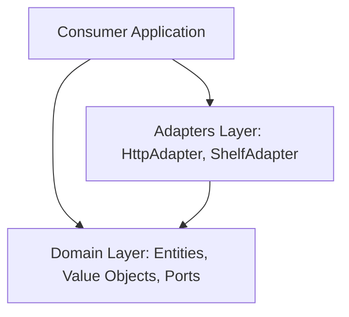

# OAuth 2.1 for Dart

A pure, platform-agnostic Dart library implementing the **OAuth 2.1 Authorization Framework** (obsoleting RFC 6749 and RFC 6750). Designed with **Clean Architecture** principles, this package provides robust, compliance-hardened components for building both **OAuth 2.1 Clients** and **OAuth 2.1 Authorization Servers**.

This package contains zero platform-specific dependencies (no `dart:io` or Flutter locks) and has a minimal supply chain, depending only on the native Dart SDK, `package:http`, `package:crypto`, `package:meta`, and `package:shelf` (for server adapters).

---

## 🏆 Key Security & Compliance Guarantees

This library implements strict, defensive validations to guarantee compile-time and runtime security matching the OAuth 2.1 specification:

*   🔒 **Mandatory PKCE (S256)**: Plain PKCE is blocked by default (`allowPlain: false` on the client, and validated on the server) to force cryptographic protection unless developers explicitly override it in constrained fallback environments.
*   🛡️ **TLS & Redirection Scheme Rules**: Enforces `https` for redirect URIs and endpoints. Cleartext HTTP is allowed exclusively on local loopback interfaces (`127.0.0.1`, `[::1]`, `::1`, or `localhost`). Native application private-use schemes are permitted *only* if they contain at least one period character (`.`).
*   📊 **Parameter Pollution Interception**: Fully generalizable check that throws an error (client) or rejects with `invalid_request` (server) if *any* parameter key (such as `code`, `state`, `client_id`, or `redirect_uri`) is duplicated in query parameters or POST bodies.
*   🧼 **ABNF Syntax Character Filters**: Protects application log components and downstream storage from parameter injection attacks by validating parameter values against strict ABNF ranges:
    *   `state` and `code` must contain only printable ASCII `VSCHAR` characters (`%x20-7E`).
    *   `error` and `error_description` must contain only `NQSCHAR` characters (`%x20-21 / %x23-5B / %x5D-7E`), explicitly banning control characters, raw newlines, carriage returns, unescaped double quotes, and backslashes.
*   🚫 **Deep Token Leakage Prevention**: Under no circumstances may an access token be appended to a query parameter string. The `OAuthAuthenticatedClient` wrapper performs a deep scan of the request URI and rejects request execution if the access token value is detected inside *any* query parameter value, preventing accidental URL channel leakages.
*   💾 **Cache-Control Enforcements**: Rejects client token response payloads that lack the `Cache-Control: no-store` header to prevent credentials from being persisted to disk. The server-side token handler ensures all token endpoint responses strictly return `Cache-Control: no-store` and `Pragma: no-cache`.
*   🔄 **Refresh Token Rotation (RTR) with Grace Window**: Enforces Refresh Token Rotation specifically targeting public clients (and optionally confidential clients). The server-side token handler automatically invalidates the parent refresh token upon rotation. If a token replay is detected, the handler revokes the entire downstream token family tree. It features a 30-second concurrency grace window allowing single-retry requests to succeed during transient network failures.
*   🚨 **Case-Insensitive Header Normalization**: Downcases all outbound header keys in `HttpAdapter` to prevent Case-Sensitive Header Map Duplication, resolving Header Field Modification vulnerabilities.
*   📦 **Heap-Space DoS & Parameter Pollution Defense**: The Shelf adapter enforces a 10 KB payload size ceiling and validates parameters at the raw query string/byte stream level before map flattening.

---

## 🏗️ Clean Architecture Layout

The package structure separates the core, pure domain rules from infrastructure and delivery adapters:



- **Domain Layer** (`lib/src/domain/`): Houses the pure protocol value objects (`CodeVerifier`, `CodeChallenge`), entities (`AuthRequest`, `TokenResult`, `ClientRegistration`, `AuthCode`, `RefreshToken`), and abstract ports/repositories (`ClientRepository`, `AuthCodeRepository`, `TokenRepository`, `CryptoService`, `OAuthHttpClient`).
- **Adapters Layer** (`lib/src/adapters/`): Adapts platform-specific dependencies (e.g. `package:http` for client HTTP requests and `package:shelf` for server adapters).

---

## 🚀 Getting Started

Add the dependency to your `pubspec.yaml`:

```yaml
dependencies:
  oauth21:
    path: ./path/to/oauth21 # or via pub.dev once published
```

This package exposes specialized entry points depending on your runtime environment:
- 📱 **Client Applications**: Import `package:oauth21/client.dart` to access core client flow APIs.
- 🖥️ **Authorization Servers**: Import `package:oauth21/server.dart` to access validators, handlers, and Shelf adapters.
- 📦 **Umbrella Exporter**: Import `package:oauth21/oauth21.dart` to export both client and server APIs simultaneously.

---

## 📖 Client-Side Usage Guide

To build a client application, start by importing `package:oauth21/client.dart`.

### 1. Initialize the OAuth 2.1 Client
Create the core coordinator using the standard `HttpAdapter` (or provide your own platform port):

```dart
import 'package:http/http.dart' as http;
import 'package:oauth21/client.dart';

final httpClient = http.Client();

final oauthClient = OAuthClient(
  authorizationEndpoint: 'https://auth.example.com/authorize',
  tokenEndpoint: 'https://auth.example.com/token',
  clientId: 'my-client-id',
  httpClient: HttpAdapter(httpClient),
  expectedIssuer: 'https://auth.example.com', // Optional: prevents mix-up attacks
);
```

### 2. Generate PKCE Secrets
Create cryptographically secure entropy keys and compute the mandatory SHA-256 challenge:

```dart
import 'package:oauth21/client.dart';

final codeVerifier = CodeVerifier.generate();
final codeChallenge = CodeChallenge.s256(codeVerifier);

print('Verifier: ${codeVerifier.value}'); // Masked in toString()
print('Challenge: ${codeChallenge.value}'); // Encoded using unpadded base64url
```

### 3. Build the Front-Channel Authorization Request
Create the validation-hardened authorization redirect URL:

```dart
import 'package:oauth21/client.dart';

final authRequest = oauthClient.createAuthorizationRequest(
  redirectUri: Uri.parse('https://client.example.com/callback'),
  state: 'secure-random-state', // CSRF state token
  codeChallenge: codeChallenge,
  scope: 'read write',
);

final authorizationUrl = authRequest.toUri();
// Direct the user agent/browser to authorizationUrl...
```

### 4. Parse & Validate Redirect Callbacks
Once the server redirects the user back, use `DefaultRequestParser` to safely process parameters:

```dart
import 'package:oauth21/client.dart';

final callbackUri = Uri.parse(
  'https://client.example.com/callback?code=auth-code-123&state=secure-random-state&iss=https%3A%2F%2Fauth.example.com',
);

const parser = DefaultRequestParser();
final redirectParams = parser.parseRedirect(callbackUri);

try {
  // Validate CSRF state token and server identity
  oauthClient.validateCallback(
    redirectParams,
    expectedState: 'secure-random-state',
  );
  
  print('Callback parameters validated successfully.');
} on StateError catch (e) {
  print('CSRF or Mix-up validation failed: $e');
}
```

### 5. Exchange Code for Access Token
Perform the out-of-band POST request to retrieve the tokens securely:

```dart
import 'package:oauth21/client.dart';

if (redirectParams.code != null) {
  final tokenResult = await oauthClient.exchangeCode(
    code: redirectParams.code!,
    codeVerifier: codeVerifier,
  );

  switch (tokenResult) {
    case TokenSuccess(:final accessToken, :final tokenType):
      print('Access Token: $accessToken');
      print('Token Type: $tokenType'); // e.g., 'Bearer'
      
    case TokenError(:final error, :final errorDescription):
      print('Authorization Error: $error - $errorDescription');
  }
}
```

### 6. Make Authenticated API Requests
Use the `OAuthAuthenticatedClient` wrapper to automatically inject token headers and prevent query leakage:

```dart
import 'package:oauth21/client.dart';

// Works with Bearer or any custom token scheme prefix
final authenticatedClient = OAuthAuthenticatedClient(
  httpClient,
  accessToken,
  tokenType: 'Bearer', // Defaults to 'Bearer'
);

// If the access token is accidentally attached to the query string,
// this call will throw a StateError before hitting the network.
final response = await authenticatedClient.get(
  Uri.parse('https://api.example.com/profile'),
);
```

---

## 📖 Server-Side Usage Guide

To build an Authorization Server, import `package:oauth21/server.dart`.

### 1. Implement Server Repository Ports

Implement the database and state tracking interfaces defined in the domain layer:

```dart
import 'package:oauth21/server.dart';

class MyClientRepository implements ClientRepository {
  @override
  Future<ClientRegistration?> findById(String clientId) async {
    // Retrieve client registration from DB
  }
}

class MyAuthCodeRepository implements AuthCodeRepository {
  @override
  Future<AuthCode?> findByCode(String code) async { ... }

  @override
  Future<void> save(AuthCode authCode) async { ... }

  @override
  Future<void> markAsUsed(String code) async { ... }

  @override
  Future<void> revokeTokensForCode(String code) async {
    // Revoke any tokens generated by this code (cascading revocation)
  }
}

class MyTokenRepository implements TokenRepository {
  @override
  Future<void> saveAccessToken(AccessToken token) async { ... }

  @override
  Future<void> saveRefreshToken(RefreshToken token) async { ... }

  @override
  Future<RefreshToken?> findRefreshTokenByHash(String hash) async { ... }

  @override
  Future<void> revokeRefreshTokenByHash(String hash) async { ... }

  @override
  Future<void> revokeAllTokensForClientAndUser(String clientId, String? userId) async {
    // Cascading revocation of all client-user tokens on refresh token replay detection
  }
}
```

### 2. Validate Authorization Endpoint Requests

Use `AuthorizeRequestValidator` to validate incoming parameters at the authorization endpoint. This validator separates **redirectable** and **non-redirectable** errors to prevent open-redirect phishing vectors.

```dart
import 'package:oauth21/server.dart';

final validator = AuthorizeRequestValidator(myClientRepository);

// params is a Map<String, List<String>> (e.g. request.requestedUri.queryParametersAll)
final result = await validator.validate(params);

if (result.isValid) {
  // Present consent/login screen to the user
  final client = result.client!;
  final scopes = result.requestedScopes;
} else if (result.isRedirectable) {
  // Safely redirect the user agent back to client's redirect URI with the error parameters
  final errorUri = result.validatedRedirectUri!.replace(
    queryParameters: {
      'error': result.errorCode!,
      'error_description': result.errorDescription!,
      if (result.state != null) 'state': result.state!,
    },
  );
} else {
  // Show error directly on screen (e.g., 400 Bad Request) to prevent open-redirection
  print('Fatal error: ${result.errorDescription}');
}
```

### 3. Process Token Endpoint Requests

Use `TokenRequestHandler` to handle token requests (Authorization Code, Refresh Token, and Client Credentials grants) securely.

```dart
import 'package:oauth21/server.dart';

final tokenHandler = TokenRequestHandler(
  clientRepository: myClientRepository,
  authCodeRepository: myAuthCodeRepository,
  tokenRepository: myTokenRepository,
  cryptoService: MyCryptoService(),
);

// Process the incoming POST request body and headers
final response = await tokenHandler.handle(
  bodyParams, // Map<String, String>
  authorizationHeader: request.headers['Authorization'],
  isHttps: true, // Enforce HTTPS channel security
);

// Send response.statusCode, response.body, and response.headers back to client
```

---

## 🌐 Shelf Adapter Middleware

Import `package:oauth21/server.dart` to use the built-in Shelf handlers to easily plug OAuth 2.1 compliance into a Shelf routing setup:

```dart
import 'package:shelf/shelf.dart' as shelf;
import 'package:shelf_router/shelf_router.dart';
import 'package:oauth21/server.dart';

final router = Router();

// 1. Authorize Endpoint
router.get('/authorize', (shelf.Request request) {
  return handleAuthorizeRequest(
    request,
    validator: authorizeValidator,
    onConsentRequired: (req, validationResult) async {
      // User consent/auth login flow...
      // Redirect back with Auth Code:
      return redirectWithAuthorizationCode(
        redirectUri: validationResult.validatedRedirectUri!,
        code: 'generated-auth-code-123',
        state: validationResult.state!,
        issuer: 'https://auth.example.com',
      );
    },
  );
});

// 2. Token Endpoint (POST)
router.post('/token', (shelf.Request request) {
  return handleTokenRequest(
    request,
    handler: tokenRequestHandler,
    isHttps: true, // enforces TLS compliance
  );
});
```

---

## 🧪 Running Tests & Diagnostics

To run the complete validation test suite (conforming to the OAuth 2.1 specification):

```bash
dart test
```

To run static analysis checks:

```bash
dart analyze
```
