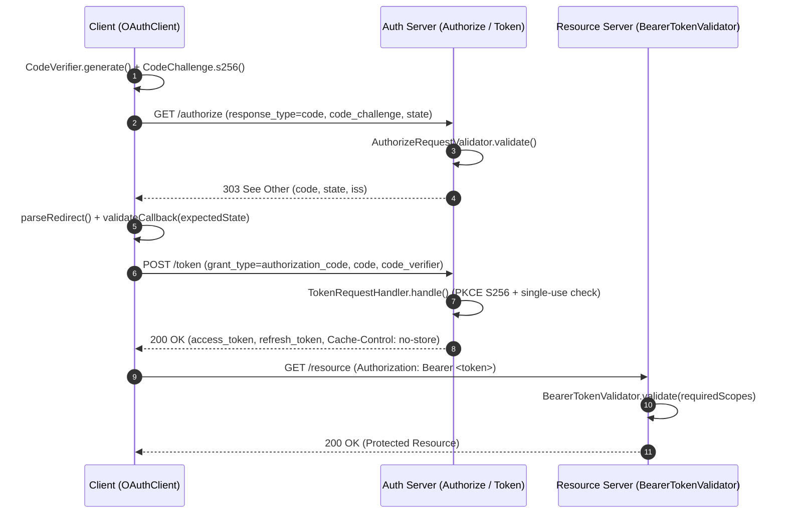

A pure, platform-agnostic Dart implementation of the **OAuth 2.1 Authorization
Framework** (`draft-ietf-oauth-v2-1-17`, replacing and obsoleting RFC 6749 and
RFC 6750 while consolidating RFC 7636, RFC 8252, RFC 9700, and RFC 10017).

Build spec-conformant **OAuth 2.1 Clients**, **Authorization Servers**, and
**Resource Servers** with mandatory S256 PKCE, refresh token rotation, issuer
mix-up defense (`iss`), and strict ABNF/URI validation—without `dart:io` or
Flutter runtime locks.

| Entrypoint | Purpose |
| :--- | :--- |
| `package:oauth21/client.dart` | Client flows, PKCE (`CodeVerifier`, `CodeChallenge`), `OAuthClient`, and `OAuthAuthenticatedClient`. |
| `package:oauth21/server.dart` | Authorization Server (`AuthorizeRequestValidator`, `TokenRequestHandler`), Resource Server (`BearerTokenValidator`), and `package:shelf` adapters. |
| `package:oauth21/oauth21.dart` | Umbrella library exporting both client and server APIs. |

## Contents

- [Protocol Overview](#protocol-overview)
- [Features & Specification Coverage](#features--specification-coverage)
- [Out of Scope](#out-of-scope)
- [Getting Started](#getting-started)
- [Usage](#usage)
  - [1. OAuth 2.1 Client](#1-oauth-21-client)
  - [2. Authorization Server](#2-authorization-server)
  - [3. Resource Server](#3-resource-server)
  - [4. Shelf HTTP Adapter & Middleware](#4-shelf-http-adapter--middleware)
- [Production Deployment Requirements](#production-deployment-requirements)
- [Where to Go Next](#where-to-go-next)

---

## Protocol Overview



---

## Features & Specification Coverage

### Supported Roles, Grants & Authentication Methods

| Capability | OAuth 2.1 Section | Key APIs |
| :--- | :--- | :--- |
| **Authorization Code Grant + PKCE (`S256`)** | Sections 4.1 & 7.5 | `CodeVerifier`, `CodeChallenge.s256`, `AuthorizeRequestValidator`, `TokenRequestHandler` |
| **Refresh Token Grant & Rotation** | Sections 4.3.1–4.3.3 | `OAuthClient.exchangeRefreshToken`, `TokenRequestHandler`, `TokenRepository.rotateRefreshToken` |
| **Client Credentials Grant** | Section 4.2 | `OAuthClient.exchangeClientCredentials`, `TokenRequestHandler` |
| **Client Authentication (`client_secret_post` & `client_secret_basic`)** | Sections 2.4.1, 3.2.1 & 3.2.4 | `ClientAuthMethod.clientSecretPost` (default), `ClientAuthMethod.clientSecretBasic` |
| **Bearer Token Resource Protection** | Sections 5.1–5.3 & 7.1 | `OAuthAuthenticatedClient`, `BearerTokenValidator`, `bearerAuthenticationMiddleware` |

### URI Scheme & Endpoint Security Policy

| URI Category | Allowed Schemes & Rules |
| :--- | :--- |
| **Authorization & Token Endpoints** | `https` required; cleartext `http` permitted only on loopback (`127.0.0.1`, `[::1]`, `localhost`) (Sections 1.5, 3.1 & 3.2). No fragments or userinfo. |
| **Client Redirect URIs** | `https`, loopback `http` (with ephemeral port matching `1..65535` per Sections 2.3.1, 4.1.1 & 8.4.2), or reverse-domain private-use native schemes (e.g. `com.example.app:/cb`, Sections 2.3.1 & 8.4.3). Relative segments (`.` / `..`), fragments, userinfo, and dangerous schemes (`javascript:`, `data:`, `file:`) are rejected (Section 7.13). |
| **Issuer Identifier (`iss`)** | `https` (or loopback `http` in local development) with non-empty host and no query or fragment components (Sections 4.1.2 & 7.15.1). |

### Built-in Protocol Defenses

- **PKCE `S256` Only**: `plain` code challenges are rejected across client and
  server APIs (Sections 4.1.1 & 7.5.2); `S256` verification uses constant-time
  comparison (`CryptoService.safeEquals`).
- **Authorization Code Replay & DoS Protection**: Single-use atomic consumption
  (`AuthCodeRepository.tryConsume`) with PKCE verification prior to family
  revocation (Sections 4.1.2, 4.1.3 & 7.5.3).
- **Refresh Token Rotation & Grace Window**: Rotates refresh tokens on every
  redemption while preserving the original grant scope and expiration ceiling
  (Sections 4.3.1 & 4.3.3), with a configurable concurrency grace window
  (default 30 seconds) and automatic family revocation on replay.
- **Query Token & Redirect Leakage Prevention**: `OAuthAuthenticatedClient`
  disables HTTP redirect following (`followRedirects = false`) and rejects
  requests if the access token appears anywhere in the request query string
  (Sections 5.1 & 7.1.3.7).
- **Parameter Pollution & ABNF Filtering**: Rejects duplicate parameters in
  query strings or form bodies (Sections 3.1 & 3.2) and validates `client_id`,
  `state`, `code`, `scope`, `grant_type`, `error`, `error_description`,
  `error_uri`, and `token_type` against OAuth 2.1 Section 5.1.1 (`token68`) and
  Appendix A ABNF rules (`VSCHAR`, `NQCHAR`, `NQSCHAR`, `name-char`).

---

## Out of Scope

To keep the baseline audit surface small and dependency-free, the following are
intentionally excluded from this package:

- **Deprecated OAuth 2.0 Grants**: The Implicit grant (`response_type=token`),
  Resource Owner Password Credentials grant (`grant_type=password`), and PKCE
  `plain` transformation are removed by OAuth 2.1 (Sections 7.5.2 & 10) and are
  not supported.
- **Bearer Tokens in Query Strings or Form Bodies**: Query-string bearer tokens
  are prohibited by OAuth 2.1 (Sections 5.1 & 7.1.3.7), and optional
  form-encoded body tokens (Section 5.1.2) are not supported; only the mandatory
  `Authorization: Bearer <token>` HTTP header (Section 5.1.1) is supported.
- **Optional OAuth 2.x Extension Specifications**: OpenID Connect (OIDC) ID
  Token / JWT verification, DPoP (RFC 9449), Pushed Authorization Requests
  (RFC 9126), Dynamic Client Registration (RFC 7591), Token Introspection
  (RFC 7662), and Token Revocation (RFC 7009) are not bundled in the core
  package.
- **Database Persistence & Login UI**: Server components depend on repository
  ports (`ClientRepository`, `AuthCodeRepository`, `TokenRepository`,
  `CryptoService`) and delegate interactive login/consent HTML rendering to your
  application.

---

## Getting Started

Add `oauth21` to your `pubspec.yaml`:

```bash
dart pub add oauth21
```

Import the entrypoint that matches your application role:

```dart
// For OAuth 2.1 client applications:
import 'package:oauth21/client.dart';

// For OAuth 2.1 authorization and resource servers:
import 'package:oauth21/server.dart';
```

---

## Usage

### 1. OAuth 2.1 Client

Use `OAuthClient` to coordinate PKCE authorization requests, callback
validation, token exchanges, and authenticated resource requests:

```dart
import 'package:http/http.dart' as http;
import 'package:oauth21/client.dart';

Future<void> runClientFlow() async {
  final httpClient = http.Client();

  final oauthClient = OAuthClient(
    authorizationEndpoint: 'https://auth.example.com/authorize',
    tokenEndpoint: 'https://auth.example.com/token',
    clientId: 'my-client-id',
    // Optional confidential client secret. Defaults to
    // ClientAuthMethod.clientSecretPost; pass
    // ClientAuthMethod.clientSecretBasic to use the Authorization header.
    clientSecret: 'my-client-secret',
    authMethod: ClientAuthMethod.clientSecretPost,
    expectedIssuer: 'https://auth.example.com',
    httpClient: HttpAdapter(httpClient),
  );

  // 1. Generate PKCE verifier and S256 challenge.
  final codeVerifier = CodeVerifier.generate();
  final codeChallenge = CodeChallenge.s256(codeVerifier);
  final redirectUri = Uri.parse('https://client.example.com/callback');
  const csrfState = 'random-csrf-token-123';

  // 2. Build the authorization redirect URI.
  final authRequest = oauthClient.createAuthorizationRequest(
    redirectUri: redirectUri,
    codeChallenge: codeChallenge,
    state: csrfState,
    scope: 'read write',
  );
  final authorizeUri = authRequest.toUri();
  print('Redirect user agent to: $authorizeUri');

  // 3. Parse and validate the callback URI from the authorization server.
  final callbackUri = Uri.parse(
    'https://client.example.com/callback'
    '?code=issued-auth-code'
    '&state=$csrfState'
    '&iss=https%3A%2F%2Fauth.example.com',
  );
  final callbackParams = oauthClient.requestParser.parseRedirect(callbackUri);
  oauthClient.validateCallback(callbackParams, expectedState: csrfState);

  // 4. Exchange the authorization code for tokens.
  final tokenResult = await oauthClient.exchangeCode(
    code: callbackParams.code!,
    codeVerifier: codeVerifier,
    redirectUri: redirectUri,
  );

  switch (tokenResult) {
    case TokenSuccess(
      :final accessToken,
      :final refreshToken,
      :final tokenType,
    ):
      // 5. Call a protected resource server using OAuthAuthenticatedClient.
      final apiClient = OAuthAuthenticatedClient(
        httpClient,
        accessToken,
        tokenType: tokenType,
      );
      final apiResponse = await apiClient.get(
        Uri.parse('https://api.example.com/v1/profile'),
      );
      print('Profile status: ${apiResponse.statusCode}');

      // 6. Refresh an access token (optionally narrowing scope).
      if (refreshToken != null) {
        final refreshed = await oauthClient.exchangeRefreshToken(
          refreshToken,
          scope: 'read',
        );
        print('Refresh result: $refreshed');
      }

    case TokenError(:final error, :final errorDescription):
      print('Token request failed: $error ($errorDescription)');
  }

  // Confidential clients can also request machine-to-machine tokens:
  final ccResult = await oauthClient.exchangeClientCredentials(scope: 'read');
  print('Client credentials result: $ccResult');
}
```

### 2. Authorization Server

Implement the four server ports (`ClientRepository`, `AuthCodeRepository`,
`TokenRepository`, and `CryptoService`), then wire `AuthorizeRequestValidator`
and `TokenRequestHandler` into your HTTP framework:

```dart
import 'package:oauth21/server.dart';

Future<void> handleServerRequests({
  required ClientRepository clientRepository,
  required AuthCodeRepository authCodeRepository,
  required TokenRepository tokenRepository,
  required CryptoService cryptoService,
  required Map<String, List<String>> authorizeQueryParams,
  required Map<String, String> tokenBodyParams,
  String? authorizationHeader,
}) async {
  // 1. Validate GET /authorize query parameters.
  final authorizeValidator = AuthorizeRequestValidator(clientRepository);
  final authResult = await authorizeValidator.validate(authorizeQueryParams);

  switch (authResult) {
    case AuthorizeRequestValid(
      :final client,
      :final validatedRedirectUri,
      :final requestedScopes,
    ):
      // Render login/consent UI, then issue an AuthCode and 303 redirect.
      print(
        'Consent needed for ${client.clientId} '
        'at $validatedRedirectUri ($requestedScopes)',
      );

    case AuthorizeRedirectableError(
      :final validatedRedirectUri,
      :final errorCode,
      :final errorDescription,
      :final state,
    ):
      // Redirect 303 back to validatedRedirectUri with error, state, and iss.
      final errorLocation = validatedRedirectUri.replace(
        queryParameters: {
          ...validatedRedirectUri.queryParameters,
          'error': errorCode,
          'error_description': errorDescription,
          if (state != null) 'state': state,
          'iss': 'https://auth.example.com',
        },
      );
      print('Redirect 303 to: $errorLocation');

    case AuthorizeDirectError(:final errorCode, :final errorDescription):
      // Do NOT redirect; render a 400 Bad Request page directly.
      print('Direct 400 error: $errorCode ($errorDescription)');
  }

  // 2. Process POST /token requests.
  final tokenHandler = TokenRequestHandler(
    clientRepository: clientRepository,
    authCodeRepository: authCodeRepository,
    tokenRepository: tokenRepository,
    cryptoService: cryptoService,
  );

  final tokenResponse = await tokenHandler.handle(
    tokenBodyParams,
    authorizationHeader: authorizationHeader,
    isHttps: true,
  );
  print('Token status: ${tokenResponse.statusCode}');
}
```

### 3. Resource Server

Use `BearerTokenValidator` directly in any Dart server framework to validate
`Authorization: Bearer <token>` headers and required scopes:

```dart
import 'package:oauth21/server.dart';

Future<void> verifyProtectedResource({
  required TokenRepository tokenRepository,
  required CryptoService cryptoService,
  required List<String> authorizationHeaders,
}) async {
  final validator = BearerTokenValidator(
    tokenRepository: tokenRepository,
    cryptoService: cryptoService,
    realm: 'example-api',
    errorUri: 'https://api.example.com/docs/errors',
  );

  final result = await validator.validate(
    authorizationHeaders: authorizationHeaders,
    requiredScopes: const {'read'},
    isHttps: true,
  );

  switch (result) {
    case BearerTokenValid(:final accessToken):
      print('Authorized subject: ${accessToken.userId}');
    case BearerTokenInvalid(:final statusCode, :final headers):
      // Return statusCode (400, 401, or 403) and headers['WWW-Authenticate'].
      print('Rejected ($statusCode): ${headers['WWW-Authenticate']}');
  }
}
```

### 4. Shelf HTTP Adapter & Middleware

When using `package:shelf`, plug `handleAuthorizeRequest`, `handleTokenRequest`,
and `bearerAuthenticationMiddleware` directly into your routes:

```dart
import 'package:oauth21/server.dart';
import 'package:shelf/shelf.dart' as shelf;

shelf.Handler buildShelfRoutes({
  required AuthorizeRequestValidator authorizeValidator,
  required TokenRequestHandler tokenHandler,
  required BearerTokenValidator bearerValidator,
  required AuthCodeRepository authCodeRepo,
  required CryptoService cryptoService,
}) {
  const issuer = 'https://auth.example.com';

  final protectedResource = const shelf.Pipeline()
      .addMiddleware(
        bearerAuthenticationMiddleware(
          validator: bearerValidator,
          requiredScopes: const {'read'},
          isHttps: true,
        ),
      )
      .addHandler((request) {
        final token = getAccessTokenFromContext(request)!;
        return shelf.Response.ok('User: ${token.userId}');
      });

  return (shelf.Request request) async {
    return switch (request.url.path) {
      'authorize' => handleAuthorizeRequest(
        request,
        validator: authorizeValidator,
        issuer: issuer,
        onConsentRequired: (req, valid) async {
          final code = cryptoService.generateRandomEntropyString();
          await authCodeRepo.save(
            AuthCode(
              code: code,
              clientId: valid.client.clientId,
              redirectUri: valid.validatedRedirectUri,
              userId: 'user-123',
              codeChallenge: valid.codeChallenge,
              codeChallengeMethod: valid.codeChallengeMethod,
              expiresAt: DateTime.now().add(const Duration(minutes: 5)),
              scope: valid.requestedScopes.join(' '),
            ),
          );
          return redirectWithAuthorizationCode(
            redirectUri: valid.validatedRedirectUri,
            code: code,
            state: valid.state,
            issuer: issuer,
          );
        },
      ),
      'token' => handleTokenRequest(
        request,
        handler: tokenHandler,
        isHttps: true,
      ),
      'resource' => protectedResource(request),
      _ => shelf.Response.notFound('Not Found'),
    };
  };
}
```

---

## Production Deployment Requirements

Protocol-level invariants are enforced automatically, but production deployments
must configure the surrounding host environment to satisfy these OAuth 2.1
requirements:

- **TLS Termination & `isHttps` (Sections 1.5, 7.6 & 7.14)**: Serve
  authorization, token, and resource endpoints over TLS. Pass `isHttps: true`
  only when `request.requestedUri.scheme == 'https'` or when a trusted reverse
  proxy has verified TLS termination.
- **Clickjacking Headers on Consent UI (Section 7.11)**: Direct error responses
  from `handleAuthorizeRequest` include `X-Frame-Options: DENY` and
  `Content-Security-Policy: frame-ancestors 'none'`. Interactive HTML login and
  consent responses returned by `onConsentRequired` must also set these headers.
- **Rate Limiting (Sections 2.4.1 & 7.7)**: Enforce brute-force rate limiting
  and account lockout controls on `/token` and login endpoints at the reverse
  proxy or middleware layer.
- **Cryptographic Entropy (Section 7.7)**: Implement
  `CryptoService.generateRandomEntropyString` with `Random.secure()` providing
  at least 128 bits (and preferably >= 160 bits; 256 bits by default) of
  entropy.
- **Atomic Persistence (Sections 4.1.2, 4.1.3 & 4.3.3)**: Implement
  `AuthCodeRepository.tryConsume`, `TokenRepository.saveIssuedTokens`, and
  `TokenRepository.rotateRefreshToken` with atomic database transactions or
  compare-and-set operations so concurrent replay attempts are reliably detected
  and trigger token family revocation.

---

## Where to Go Next

- **Runnable End-to-End Demo**: See
  [`example/oauth21_example.dart`](example/oauth21_example.dart) for a complete,
  self-contained script running an in-memory Shelf Authorization Server and
  `OAuthClient` flow (`dart run example/oauth21_example.dart`).
- **Roadmap**: Planned follow-up work includes optional OAuth 2.x security
  extensions such as Demonstrating Proof-of-Possession (DPoP, RFC 9449).
- **Issues & Feedback**: File bugs or feature requests on the
  [GitHub issue tracker](https://github.com/dropbear-software/oauth21/issues).
- **Contributing**: Run `dart format .`, `dart analyze --fatal-infos`, and
  `dart test` before opening a pull request.
