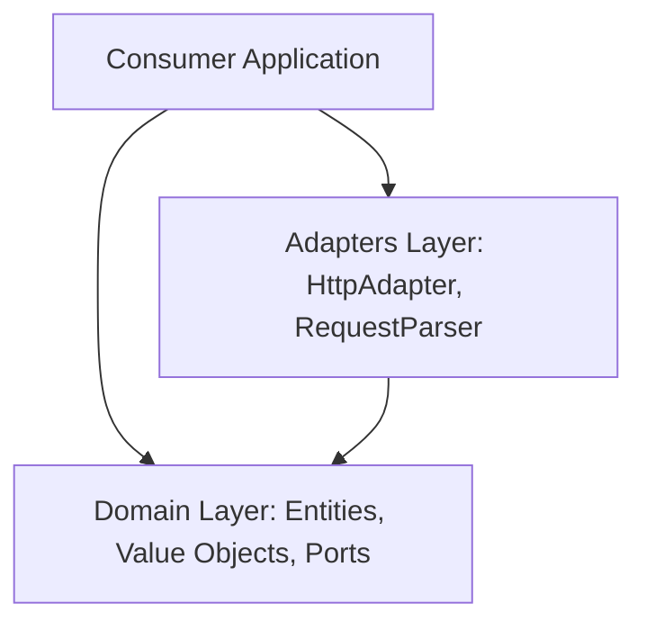

# OAuth 2.1 Client for Dart

A pure, platform-agnostic Dart client library implementing the **OAuth 2.1 Authorization Framework** (obsoleting RFC 6749 and RFC 6750). 

Built with **Clean Architecture** principles, this package contains zero platform-specific dependencies (no `dart:io` or Flutter locks) and has a minimal supply chain, depending only on the native Dart SDK, `package:http`, `package:crypto`, and `package:meta`.

---

## 🏆 Key Security & Compliance Guarantees

This library implements strict, defensive validations to guarantee compile-time and runtime security matching the OAuth 2.1 specification:

*   🔒 **Mandatory PKCE (S256)**: Plain PKCE is blocked by default (`allowPlain: false`) to force cryptographic protection unless developers explicitly override it in constrained fallback environments.
*   🛡️ **TLS & Redirection Scheme Rules**: Enforces `https` for redirect URIs and endpoints. HTTP is allowed exclusively on local loopback interfaces (`127.0.0.1`, `[::1]`, or `localhost`). Native application private-use schemes are permitted *only* if they contain at least one period character (`.`).
*   📊 **Parameter Pollution Interception**: Fully generalizable check that throws an `ArgumentError` if *any* parameter key (such as `code`, `state`, or `iss`) is duplicated in callback redirect URIs.
*   🧼 **ABNF Syntax Character Filters**: Protects application log components and downstream storage from parameter injection attacks by validating parameter values against strict ABNF ranges:
    *   `state` and `code` must contain only printable ASCII `VSCHAR` characters (`%x20-7E`).
    *   `error` and `error_description` must contain only `NQSCHAR` characters (`%x20-21 / %x23-5B / %x5D-7E`), explicitly banning control characters, raw newlines, carriage returns, unescaped double quotes, and backslashes.
*   🚫 **Deep Token Leakage Prevention**: Under no circumstances may an access token be appended to a query parameter string. The `OAuthAuthenticatedClient` wrapper performs a deep scan of the request URI and rejects request execution if the access token value is detected inside *any* query parameter value, preventing accidental URL channel leakages.
*   💾 **Cache-Control Enforcements**: Rejects token response payloads that lack the `Cache-Control: no-store` header to prevent credentials from being persisted to disk.
*   🔑 **Extensible Token Types**: Supports both standard `Bearer` tokens and advanced sender-constrained tokens (like `DPoP` or absolute URI-based token types).
*   📇 **Form-Encoded Client Credentials**: Separately form-encodes client credentials (`clientId` and `clientSecret`) conforming to `application/x-www-form-urlencoded` before joining and base64-encoding them for `Basic` authentication, complying with Section 2.3.1.
*   🪵 **Log Leakage Protection**: Automatically masks sensitive information (like access tokens and PKCE challenges) inside `toString()` representations.

---

## 🏗️ Clean Architecture Layout

The package structure separates the core, pure domain rules from infrastructure and delivery adapters:



- **Domain Layer** (`lib/src/domain/`): Houses the pure protocol value objects (`CodeVerifier`, `CodeChallenge`), entities (`AuthRequest`, `TokenResult`), and abstract ports (`OAuthHttpClient`, `OAuthRequestParser`).
- **Adapters Layer** (`lib/src/adapters/`): Adapts platform-specific dependencies (e.g. `package:http`) to target domain interfaces.

---

## 🚀 Getting Started

Add the dependency to your `pubspec.yaml`:

```yaml
dependencies:
  oauth21:
    path: ./path/to/oauth21 # or via pub.dev once published
```

---

## 📖 Usage Guide

### 1. Initialize the OAuth 2.1 Client
Create the core coordinator using the standard `HttpAdapter` (or provide your own platform port):

```dart
import 'package:http/http.dart' as http;
import 'package:oauth21/oauth21.dart';

final httpClient = http.Client();

final oauthClient = OAuthClient(
  authorizationEndpoint: 'https://auth.example.com/authorize',
  tokenEndpoint: 'https://auth.example.com/token',
  clientId: 'my-client-id',
  httpClient: HttpAdapter(httpClient),
  expectedIssuer: 'https://auth.example.com', // Optional: prevents mix-up attacks
);
```

### 2. Generate PKCE Secrets
Create cryptographically secure entropy keys and compute the mandatory SHA-256 challenge:

```dart
final codeVerifier = CodeVerifier.generate();
final codeChallenge = CodeChallenge.s256(codeVerifier);

print('Verifier: ${codeVerifier.value}'); // Masked in toString()
print('Challenge: ${codeChallenge.value}'); // Encoded using unpadded base64url
```

### 3. Build the Front-Channel Authorization Request
Create the validation-hardened authorization redirect URL:

```dart
final authRequest = oauthClient.createAuthorizationRequest(
  redirectUri: Uri.parse('https://client.example.com/callback'),
  state: 'secure-random-state', // CSRF state token
  codeChallenge: codeChallenge,
  scope: 'read write',
);

final authorizationUrl = authRequest.toUri();
// Direct the user agent/browser to authorizationUrl...
```

### 4. Parse & Validate Redirect Callbacks
Once the server redirects the user back, use `DefaultRequestParser` to safely process parameters:

```dart
final callbackUri = Uri.parse(
  'https://client.example.com/callback?code=auth-code-123&state=secure-random-state&iss=https%3A%2F%2Fauth.example.com',
);

const parser = DefaultRequestParser();
final redirectParams = parser.parseRedirect(callbackUri);

try {
  // Validate CSRF state token and server identity
  oauthClient.validateCallback(
    redirectParams,
    expectedState: 'secure-random-state',
  );
  
  print('Callback parameters validated successfully.');
} on StateError catch (e) {
  print('CSRF or Mix-up validation failed: $e');
}
```

### 5. Exchange Code for Access Token
Perform the out-of-band POST request to retrieve the tokens securely over HTTPS:

```dart
if (redirectParams.code != null) {
  final tokenResult = await oauthClient.exchangeCode(
    code: redirectParams.code!,
    codeVerifier: codeVerifier,
  );

  switch (tokenResult) {
    case TokenSuccess(:final accessToken, :final tokenType):
      print('Access Token: $accessToken');
      print('Token Type: $tokenType'); // e.g., 'Bearer' or 'DPoP'
      
    case TokenError(:final error, :final errorDescription):
      print('Authorization Error: $error - $errorDescription');
  }
}
```

### 6. Make Authenticated API Requests
Use the `OAuthAuthenticatedClient` wrapper to automatically inject token headers and prevent query leakage:

```dart
// Works with Bearer, DPoP, or any custom token scheme prefix
final authenticatedClient = OAuthAuthenticatedClient(
  httpClient,
  accessToken,
  tokenType: 'Bearer', // Defaults to 'Bearer'
);

// If the access token is accidentally attached to the query string,
// this call will throw a StateError before hitting the network.
final response = await authenticatedClient.get(
  Uri.parse('https://api.example.com/profile'),
);
```

---

## 🧪 Running Tests & Diagnostics

To run the complete adversarial validation test suite containing 94 specifications-conforming tests:

```bash
dart test
```

To run static analysis checks:

```bash
dart analyze
```
