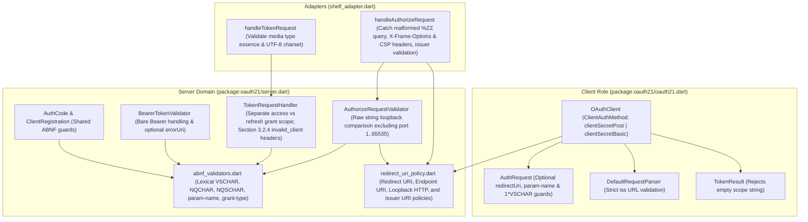

# OAuth 2.1 (`draft-ietf-oauth-v2-1-17`) Baseline Conformance & Security Remediation

*   **Author:** mark
*   **Status:** Approved
*   **Date:** 2026-11-05

--------------------------------------------------------------------------------

## Overview

`oauth21` is a pure-Dart library implementing the OAuth 2.1 Authorization Framework (`draft-ietf-oauth-v2-1-17`) across all three core protocol roles: Client (`package:oauth21/oauth21.dart`), Authorization Server, and Resource Server (`package:oauth21/server.dart`), along with HTTP (`package:http`) and server (`package:shelf`) adapters.

Before publishing the package for production use, this design addresses all remaining normative protocol, security, and documentation discrepancies identified in a section-by-section audit of [draft-ietf-oauth-v2-1-17.txt](../../draft-ietf-oauth-v2-1-17.txt) (Sections 1–10 and Appendices A–C).

## The Problem

Earlier security reviews of `oauth21` (`v0.2.0`) remediated specific high-severity vulnerabilities—enforcing `S256`-only PKCE, constant-time secret and PKCE verification, single-use authorization codes with replay family revocation, and strict redirect URI scheme validation. However, reactive bug fixes and 100% line coverage of existing code do not guarantee that every normative `MUST`, `MUST NOT`, and `SHOULD` requirement in `draft-ietf-oauth-v2-1-17` is implemented.

A full specification audit against `draft-ietf-oauth-v2-1-17.txt` uncovered 11 concrete conformance and security gaps (`GAP-01` through `GAP-11`) that affect production deployments:

1. **Refresh Token Grant Scope Loss (`GAP-01`, Sections 4.3, 4.3.1, 4.3.3)**: Requesting a narrowed access token scope during a refresh token exchange permanently overwrites the rotated refresh token's scope with the narrowed scope, violating Section 4.3.3 and preventing the client from later obtaining access tokens for other scopes covered by the original grant.
2. **Client Authentication Interoperability & Error Headers (`GAP-02`, Sections 2.4.1, 3.2.4, 10)**: OAuth 2.1 requires authorization servers to support `client_secret_post` (credentials in the POST body) and makes `client_secret_basic` optional. Currently, `OAuthClient` only supports `Authorization: Basic` (while also sending a redundant `client_id` in the body), and `TokenRequestHandler` unconditionally returns `401 Unauthorized` with `WWW-Authenticate: Basic` even when `client_secret_post` fails without an `Authorization` header.
3. **Loopback Redirect URI Normalization (`GAP-03`, Sections 2.3.1, 4.1.1, 8.4.2)**: `AuthorizeRequestValidator` compares loopback redirect URIs using parsed Dart `Uri` properties rather than raw character-by-character string comparison outside the port component, allowing percent-encoding normalization and case-folding that violate Section 4.1.1.
4. **Incomplete ABNF & Constructor Guards (`GAP-04`, `GAP-05`, `GAP-08`, `GAP-10`, Appendices A & C)**:
    * `AuthRequest` permits empty or whitespace-only `clientId` values (which `toUri()` strips, emitting an invalid authorization URL without `client_id`), skips validation on whitespace-only `scope`, does not validate `customParameters` against Appendix A.16 `param-name` syntax, and requires `redirectUri` even when a client has a single registered redirect URI (Section 2.3.2).
    * `TokenResult` accepts empty `"scope": ""` strings in token responses, violating Appendix A.4 (`1*NQCHAR`).
    * `TokenRequestHandler` does not validate `grant_type` against Appendix A.10 / Section 6.3 before checking client grant authorization.
    * `AuthCode` and `ClientRegistration` duplicate inline regular expressions instead of sharing `abnf_validators.dart`, and `AuthCode` does not validate `codeChallenge` or `scope` syntax in its constructor.
5. **Adapter & Resource Server Edge Cases (`GAP-06`, `GAP-07`, `GAP-09`, Sections 3.1, 3.2.2, 5.3, 7.11)**:
    * `handleAuthorizeRequest` in `shelf_adapter.dart` throws an unhandled `FormatException` when `request.requestedUri` contains malformed percent-encoding (e.g., `%ZZ`), omits clickjacking defense headers (`X-Frame-Options: DENY` and `Content-Security-Policy: frame-ancestors 'none'`) on direct error responses (Section 7.11), and does not validate the `issuer` parameter syntax (Section 4.1.2 / 7.15.1).
    * `handleTokenRequest` does not reject non-UTF-8 `charset` parameters on `application/x-www-form-urlencoded` requests (Section 3.2.2).
    * `BearerTokenValidator` lacks optional `errorUri` support for `WWW-Authenticate` challenges (Section 5.3.1) and returns `401 invalid_token` on a bare `Authorization: Bearer` header with no token value instead of treating it as an unauthenticated request (bare `WWW-Authenticate: Bearer` without an `error` code per Section 5.3.1 and Section 5.3.2).
6. **Out-of-Date Documentation (`GAP-11`)**: `README.md` contains server examples missing the mandatory `issuer` / `iss` parameter and omits documentation for `BearerTokenValidator`, `bearerAuthenticationMiddleware`, `ClientAuthMethod`, and host-level security responsibilities.

## Goals

*   **Close All 11 Specification Gaps**: Remediate `GAP-01` through `GAP-11` across `lib/`, `test/`, and `README.md` in full compliance with `draft-ietf-oauth-v2-1-17`.
*   **Support Mandatory `client_secret_post` by Default on `OAuthClient`**: Introduce `ClientAuthMethod` (`clientSecretPost`, `clientSecretBasic`) on `OAuthClient`, defaulting to `clientSecretPost` per Section 2.4.1 while supporting `clientSecretBasic` without redundant body parameters.
*   **Enforce Section 3.2.4 `WWW-Authenticate` Rules on `TokenRequestHandler`**: Return `401 Unauthorized` with `WWW-Authenticate: Basic` only when the client attempted `Authorization` header authentication or omitted required credentials, and return `400 Bad Request` (`invalid_client`) without `WWW-Authenticate` when `client_secret_post` authentication fails.
*   **Preserve Parent Refresh Token Scope on Down-Scoped Rotation**: Ensure `TokenRequestHandler` narrows only the issued `AccessToken.scope` while retaining `oldRefreshToken.scope` on the rotated `RefreshToken` per Section 4.3.3.
*   **Enforce Strict RFC 3986 / Appendix A Syntax**: Enforce exact character-by-character comparison on loopback redirect URIs outside the port (`1..65535`) and complete Appendix A ABNF validation across all client and server entities.
*   **Maintain 100% Line Coverage and Zero Analyzer Warnings**: Verify all changes with `dart format .`, `dart analyze --fatal-infos`, and 100.0% line coverage across `lib/`.

## Non-Goals

*   **Sender-Constrained Tokens (Section 1.4.3)**: Implementing DPoP (RFC 9449) or mTLS (RFC 8705) is deferred to a future milestone.
*   **Extension Grant Types (Section 4.4)**: Implementing JWT Bearer, SAML2, or Device Authorization grants is out of scope.
*   **Dynamic Client Registration & Metadata Discovery**: Implementing RFC 7591 or RFC 8414 endpoints is out of scope.
*   **Database Adapter Implementations**: Providing SQL, NoSQL, or Redis implementations of `ClientRepository`, `AuthCodeRepository`, or `TokenRepository` is out of scope.

## Open Questions

None. All architectural questions raised during brainstorming (including defaulting `OAuthClient.authMethod` to `ClientAuthMethod.clientSecretPost` per Section 2.4.1) have been resolved.

## Critical User Journeys (CUJs)

### CUJ 1: Down-Scoped Refresh Token Rotation Preserves Original Grant Scope

*   **Given**: A client holds a valid `RefreshToken` originally granted with `scope: "read write"`.
*   **When**: The client submits a `refresh_token` request with narrowed `scope: "read"`, and subsequently uses the newly rotated refresh token to request `scope: "write"`.
*   **Then**: The first refresh returns an `AccessToken` with `scope: "read"` and a rotated `RefreshToken` whose stored grant scope remains `"read write"`. The second refresh succeeds and issues an `AccessToken` with `scope: "write"`.

### CUJ 2: Confidential Client Authentication via `client_secret_post` and `client_secret_basic`

*   **Given**: A confidential client configured with `OAuthClient` (default `ClientAuthMethod.clientSecretPost` or explicit `ClientAuthMethod.clientSecretBasic`) and a `TokenRequestHandler` on the authorization server.
*   **When**: The client exchanges an authorization code or refresh token, or presents invalid credentials using either method.
*   **Then**:
    *   With `clientSecretPost`, `OAuthClient` sends `client_id` and `client_secret` in the form-encoded POST body without an `Authorization` header; if the secret is wrong, `TokenRequestHandler` returns `400 Bad Request` (`{"error": "invalid_client"}`) with no `WWW-Authenticate` header.
    *   With `clientSecretBasic`, `OAuthClient` sends `Authorization: Basic <encoded>` and omits `client_id` and `client_secret` from the POST body; if the header credentials fail, `TokenRequestHandler` returns `401 Unauthorized` with `WWW-Authenticate: Basic`.

### CUJ 3: Native App Loopback Redirect URI Validation with Ephemeral Port

*   **Given**: A native public client registered with `http://127.0.0.1/callback`.
*   **When**: The client initiates `/authorize` with `redirect_uri=http://127.0.0.1:54321/callback` vs. a normalized/case-altered `redirect_uri=HTTP://127.0.0.1:54321/callback` or `http://127.0.0.1:54321/%63allback`.
*   **Then**: `AuthorizeRequestValidator` accepts `http://127.0.0.1:54321/callback` because it matches character-for-character outside the valid ephemeral port, and rejects the case-altered or percent-encoded variants with `AuthorizeDirectError` (`400 invalid_request`).

### CUJ 4: Authorization & Resource Server Hardened HTTP Handling

*   **Given**: An authorization server using `handleAuthorizeRequest` and `handleTokenRequest`, and a resource server using `bearerAuthenticationMiddleware`.
*   **When**: A request arrives at `/authorize` with malformed `%ZZ` query encoding, at `/token` with `Content-Type: application/x-www-form-urlencoded; charset=latin1`, or at a protected resource with a bare `Authorization: Bearer` header.
*   **Then**:
    *   `/authorize` returns `400 Bad Request` with `X-Frame-Options: DENY` and `Content-Security-Policy: frame-ancestors 'none'` instead of throwing an unhandled `FormatException`.
    *   `/token` rejects the non-UTF-8 charset with `400 invalid_request` and `Cache-Control: no-store`.
    *   The resource server returns `401 Unauthorized` with a bare `WWW-Authenticate: Bearer` header (and optional `error_uri` when an error code is present).

## Technical Plan (Architecture)

The remediation preserves the existing ports-and-adapters architecture of `oauth21`, keeping `lib/src/domain/` free of server framework dependencies while enforcing HTTP transport and header rules in `lib/src/adapters/`.

### 1. Lexical ABNF vs. URI Policy Boundaries (`abnf_validators.dart` & `redirect_uri_policy.dart`)

*   **Lexical ABNF Validation (`abnf_validators.dart`)**:
    *   Centralizes all Appendix A character-class and grammar checks (`VSCHAR`, `NQCHAR`, `NQSCHAR`, `scope`, `code-verifier`, `error-uri`, Appendix A.16 `param-name`, and Appendix A.10 / Section 6.3 `grant-type` matching either `grant-name` or an absolute `NQCHAR` URI without fragment).
    *   Consolidates duplicate inline regular expressions across `AuthCode`, `ClientRegistration`, and `TokenResult` into `abnf_validators.dart`, and validates `codeChallenge` and `scope` on `AuthCode` construction.
*   **URI Policy Validation (`redirect_uri_policy.dart`)**:
    *   Keeps all URI structure and transport policy checks (`isAllowedRedirectUri`, `isAllowedHttpEndpointUri`, `isLoopbackHost`, `isLoopbackHttpUri`, and `isValidIssuerUri`) in `redirect_uri_policy.dart`.
    *   `isValidIssuerUri` enforces Section 4.1.2 / Section 7.15.1 / RFC 9207 issuer identifier rules (`https` scheme or allowed loopback `http`, non-empty host, no `userInfo`, no query component, and no fragment component).

### 2. Refresh Token Scope Preservation on Rotation (`token_request_handler.dart`)

*   Separates the issued access token scope from the rotated refresh token's underlying grant scope during token issuance.
*   When a client requests a narrowed scope during a `refresh_token` exchange, `TokenRequestHandler` narrows only the newly issued `AccessToken.scope` (and JSON response `scope`) while preserving the parent `RefreshToken.scope` on the rotated `RefreshToken` per Section 4.3 and Section 4.3.3.

### 3. Client Authentication Methods & `invalid_client` Error Semantics (`oauth_client.dart` & `token_request_handler.dart`)

*   **Client Role (`oauth_client.dart`)**:
    *   Introduces `enum ClientAuthMethod { clientSecretPost, clientSecretBasic }` on `OAuthClient`, defaulting to `ClientAuthMethod.clientSecretPost` per Section 2.4.1.
    *   Validates `clientId`, non-empty `clientSecret`, `authorizationEndpoint`, `tokenEndpoint`, and `expectedIssuer` in the `OAuthClient` constructor.
    *   Sends `client_id` and `client_secret` in the POST body when `clientSecretPost` is active, and sends `Authorization: Basic` without redundant body `client_id` or `client_secret` parameters when `clientSecretBasic` is active (Section 2.4.1 and Section 4.1.3).
*   **Server Role (`token_request_handler.dart`)**:
    *   Validates `grant_type` syntax against Appendix A.10 / Section 6.3 before checking `client.allowedGrantTypes`, returning `400 invalid_request` on malformed syntax.
    *   Distinguishes `Authorization` header failures from `client_secret_post` body failures per Section 3.2.4: returns `401 Unauthorized` with `WWW-Authenticate: Basic` when the client attempted `Authorization` header authentication or omitted required confidential credentials, and returns `400 Bad Request` (`invalid_client`) without `WWW-Authenticate` when `client_secret_post` authentication fails.

### 4. Strict Loopback Redirect URI Comparison (`authorize_request_validator.dart`)

*   When both the registered and requested redirect URIs are loopback `http` URIs (`localhost`, `127.0.0.1`, or `[::1]`), `AuthorizeRequestValidator` validates that any explicit port in the requested URI is a valid integer in `1..65535` without leading zeroes, strips only the optional `:port` authority segment from the raw URI strings, and compares the resulting strings character-by-character with no case-folding or percent-encoding normalization per Section 4.1.1 and Section 8.4.2.

### 5. `AuthRequest`, `TokenResult`, and `DefaultRequestParser` Hardening

*   **`AuthRequest`**: Makes `redirectUri` optional (`Uri?`) for single-redirect-URI clients (Section 2.3.2), requires non-empty `1*VSCHAR` for `clientId` and `state`, rejects empty or whitespace-only `scope`, and validates `customParameters` keys (`param-name`) and values (`1*VSCHAR`).
*   **`TokenResult`**: Rejects empty `"scope": ""` strings in token responses with `FormatException` per Appendix A.4 (`1*NQCHAR`).
*   **`DefaultRequestParser`**: Validates the `iss` authorization response parameter with `isValidIssuerUri` per Section 4.1.2 and Section 7.15.1.

### 6. Resource Server & Shelf Adapter Hardening (`bearer_token_validator.dart` & `shelf_adapter.dart`)

*   **`BearerTokenValidator`**: Configures optional `errorUri` on `BearerTokenValidator` (propagated to `BearerTokenInvalid` and `WWW-Authenticate` challenges when an error code is emitted) and treats a bare `Authorization: Bearer` header with no token characters as an unauthenticated request (`401` with bare `WWW-Authenticate: Bearer` and no `error` code per Section 5.3.1 and Section 5.3.2).
*   **`shelf_adapter.dart`**: Validates `issuer` with `isValidIssuerUri`, adds clickjacking defense headers (`X-Frame-Options: DENY` and `Content-Security-Policy: frame-ancestors 'none'`) to all direct `/authorize` responses (Section 7.11), catches malformed `%ZZ` query encoding on `/authorize` to return `400 invalid_request` instead of `500`, and rejects non-UTF-8 `charset` parameters on `/token` (Section 3.2.2).

## Alternatives Considered

### Alternative A: Documentation-Only Audit Report Without Code Remediation

*   **Pros**: Zero risk of altering existing runtime behavior or updating unit tests; faster to produce.
*   **Cons**: Leaves known specification violations in `lib/` (such as refresh token scope loss on down-scoped refresh requests, missing `client_secret_post` support on `OAuthClient`, unconditional `401` + `WWW-Authenticate: Basic` on body credential failures, and URI normalization in loopback redirect matching).
*   **Reason for Rejection**: Rejected because the objective is a production-ready baseline release of `oauth21` that conforms to `draft-ietf-oauth-v2-1-17` at runtime, not just a static gap list.

### Alternative B: Defaulting `OAuthClient` to `ClientAuthMethod.clientSecretBasic`

*   **Pros**: Matches the legacy behavior of `OAuthClient` in `v0.2.0` where providing a `clientSecret` always generated an `Authorization: Basic` header.
*   **Cons**: OAuth 2.1 Section 2.4.1 and Section 10 make `client_secret_post` mandatory to implement for authorization servers and `client_secret_basic` optional due to historical double-encoding bugs (`application/x-www-form-urlencoded` inside `base64`). A client that defaults to `client_secret_basic` can fail against a compliant OAuth 2.1 authorization server that only implements mandatory `client_secret_post`.
*   **Reason for Rejection**: Rejected because `oauth21` has not yet been published and has no legacy API constraints; defaulting `OAuthClient` to `ClientAuthMethod.clientSecretPost` aligns with Section 2.4.1 while still offering `ClientAuthMethod.clientSecretBasic` for servers that use HTTP Basic.

### Alternative C: Exporting a Separate Public Port Contract Test Package in This Milestone

*   **Pros**: Allows consumers implementing `ClientRepository`, `AuthCodeRepository`, and `TokenRepository` against external databases to import and run pre-built concurrency and replay tests directly in their own test suites.
*   **Cons**: Expands the public package surface area and either introduces `package:test` into `dependencies` or requires maintaining a second companion package before the baseline protocol implementation is released.
*   **Reason for Rejection**: Rejected for this baseline release to keep runtime dependencies minimal (`crypto`, `http`, `meta`, `shelf`). Instead, port contract invariants (atomic single-use consumption, grace-window rotation, and authorization code lineage revocation) are documented on the port interfaces and verified in `test/`.

--------------------------------------------------------------------------------

## Risks & Mitigations

*   **API & Behavioral Tightening Across Unreleased `v0.2.0` Surface**:
    *   *Risk*: Removing `const` from `OAuthClient(...)`, changing the default confidential client auth method to `ClientAuthMethod.clientSecretPost`, making `AuthRequest.redirectUri` nullable (`Uri?`), and rejecting empty `"scope": ""` in `TokenResult` or bare `Authorization: Bearer` with `invalid_token` alter existing test expectations.
    *   *Mitigation*: `oauth21` is pre-release (`0.2.0`); all affected unit and integration tests in `test/` and examples in `README.md` are updated in lockstep with the code changes.
*   **Reverse-Proxy TLS Detection (`isHttps`)**:
    *   *Risk*: If a host application deploys behind a reverse proxy and blindly trusts unvalidated `X-Forwarded-Proto` headers, an attacker could bypass HTTPS transport enforcement.
    *   *Mitigation*: `shelf_adapter.dart` defaults strictly to `request.requestedUri.scheme == 'https'` and requires an explicit host-supplied `bool Function(Request)? isHttps` callback when terminating TLS at a trusted proxy, documented in the README security checklist.
*   **Host-Rendered Consent UI Framing (`onConsentRequired`)**:
    *   *Risk*: While `handleAuthorizeRequest` attaches `X-Frame-Options: DENY` and `Content-Security-Policy: frame-ancestors 'none'` to all direct responses, the host application constructs the `shelf.Response` returned by `onConsentRequired`.
    *   *Mitigation*: Document in `README.md` and `handleAuthorizeRequest` doc comments that custom HTML consent responses returned by `onConsentRequired` MUST include `X-Frame-Options: DENY` and `Content-Security-Policy: frame-ancestors 'none'` per Section 7.11.
*   **Brute-Force Rate Limiting & Atomic Repository Semantics**:
    *   *Risk*: `TokenRequestHandler` and repository port interfaces operate per-request in memory and cannot enforce network-level rate limiting or database-level locks on their own.
    *   *Mitigation*: Document rate-limiting requirements for `client_secret` authentication (Section 2.4.1) and atomic compare-and-set requirements on `AuthCodeRepository` and `TokenRepository` in both port docstrings and `README.md`.

## Non-Functional Requirements

*   **Security & Privacy**:
    *   All secret and PKCE comparisons must continue using constant-time comparison (`CryptoService.safeEquals`).
    *   All direct HTTP responses on `/authorize` in `shelf_adapter.dart` must include `X-Frame-Options: DENY`, `Content-Security-Policy: frame-ancestors 'none'`, `Cache-Control: no-store`, and `Pragma: no-cache`.
    *   All token endpoint responses (both `200` and errors) and resource server error responses must include `Cache-Control: no-store`.
*   **Performance & Latency**:
    *   All new ABNF and URI regular expressions in `abnf_validators.dart`, `authorize_request_validator.dart`, and `shelf_adapter.dart` must be pre-compiled `final RegExp` constants with linear-time character-class matching (no catastrophic backtracking).
*   **Code Quality & Formatting**:
    *   All Dart files must adhere to the 80-column line limit (`lines_longer_than_80_chars`), pass `dart analyze --fatal-infos` with zero issues, and maintain 100.0% line coverage across `lib/`.

--------------------------------------------------------------------------------

## Additional Resources

*   [draft-ietf-oauth-v2-1-17.txt](../../draft-ietf-oauth-v2-1-17.txt) — *The OAuth 2.1 Authorization Framework* (31 October 2026).
*   [concepts_brief.md](../../concepts_brief.md) — Multi-lens brainstorm synthesis and gap analysis (`GAP-01` through `GAP-11`).

## Future Improvements

*   **Sender-Constrained Access Tokens (Section 1.4.3)**: Add support for Demonstrating Proof of Possession (DPoP, RFC 9449) across `OAuthClient`, `TokenRequestHandler`, and `BearerTokenValidator`.
*   **Reusable Port Contract Test Suite**: Publish a companion test helper or `test/` utility for third-party database implementations of `TokenRepository` and `AuthCodeRepository`.

--------------------------------------------------------------------------------

## Detailed Implementation Plan

The implementation is partitioned into 4 incremental phases so that each phase leaves the repository compiling cleanly and passing `dart analyze --fatal-infos` and phase-scoped tests.

### Phase 1: Shared Lexical ABNF & URI Policy Modules

#### 1. [`../../lib/src/domain/abnf_validators.dart`](../../lib/src/domain/abnf_validators.dart) (Modify)

*   **Type / Scope**: Domain Lexical Validation Module
*   **Proposed Changes**:
    *   Add `final RegExp paramNameAbnfRegex = RegExp(r'^[A-Za-z0-9\-._]+$');` to enforce Appendix A.16 (`param-name = 1*name-char`, where `name-char = "-" / "." / "_" / DIGIT / ALPHA`).
    *   Add `bool isValidGrantTypeParam(String value)` to enforce Appendix A.10 (`grant-type = grant-name / URI-reference`) and Section 6.3 (extension grant types must be absolute URIs without fragments): returns `true` iff `paramNameAbnfRegex.hasMatch(value)` holds OR (`nqcharRequiredRegex.hasMatch(value)` && `!value.contains('#')` && `(Uri.tryParse(value)?.isAbsolute ?? false)`).
    *   Remove the `{bool allowEmpty = false}` optional parameter from `isValidScopeString(String scope)` so empty scope strings always return `false` per Appendix A.4 (`1*NQCHAR`).
    *   **Rationale**: Centralizes lexical Appendix A.4, A.10, and A.16 checks in `abnf_validators.dart` without introducing cross-module URI policy dependencies (`GAP-05`, `GAP-08`, `GAP-10`).

#### 2. [`../../lib/src/domain/redirect_uri_policy.dart`](../../lib/src/domain/redirect_uri_policy.dart) (Modify)

*   **Type / Scope**: Domain URI Policy Module
*   **Proposed Changes**:
    *   Import `abnf_validators.dart`.
    *   Add `bool isLoopbackHttpUri(Uri uri)` returning `uri.hasScheme && uri.scheme.toLowerCase() == 'http' && uri.hasAuthority && uri.userInfo.isEmpty && isLoopbackHost(uri.host)`.
    *   Add `bool isValidIssuerUri(String value, {bool allowLoopbackHttp = false})` to enforce Section 4.1.2 / Section 7.15.1 / RFC 9207 issuer identifier syntax: verifies `isValidVscharParam(value)`, parses `final uri = Uri.tryParse(value)`, checks `uri != null && isAllowedHttpEndpointUri(uri, allowLoopbackHttp: allowLoopbackHttp)`, and ensures `!uri.hasQuery && !value.contains('?') && !uri.hasFragment && !value.contains('#')`.
    *   **Rationale**: Keeps all URI scheme, authority, loopback, and issuer policy checks in `redirect_uri_policy.dart` (`GAP-03`, `GAP-06`).

### Phase 2: Client Entities, Redirect Parser & `OAuthClient`

#### 3. [`../../lib/src/domain/entities/auth_request.dart`](../../lib/src/domain/entities/auth_request.dart) (Modify)

*   **Type / Scope**: Client Domain Entity
*   **Proposed Changes**:
    *   Change `final Uri redirectUri;` to `final Uri? redirectUri;` and change the constructor parameter from `required this.redirectUri` to `this.redirectUri` so single-redirect-URI clients can omit `redirect_uri` on `/authorize` per Section 2.3.2 and Section 4.1.1.
    *   Guard the redirect URI policy check with `if (redirectUri != null && !isAllowedRedirectUri(redirectUri!))`.
    *   Validate `clientId` using `isValidVscharParam(clientId)` instead of `vscharOptionalRegex`, rejecting empty or whitespace-padded `clientId` values.
    *   Validate `scope` whenever `scope != null` using `isValidScopeString(scope!)` (replacing `scope!.trim().isNotEmpty && !isValidScopeString(scope!)` so empty `""` or whitespace-only `"   "` strings throw `ArgumentError.value`).
    *   Validate `state` whenever `state != null` using `isValidVscharParam(state!)` (rejecting empty or whitespace-padded `state` values).
    *   Validate `customParameters` keys using `paramNameAbnfRegex.hasMatch(key)` (Appendix A.16) and values using `isValidVscharParam(value)` (Appendix A.16 / Section 6.2), throwing `ArgumentError` if any custom key or value is malformed.
    *   In `toUri()`, include `if (redirectUri != null) 'redirect_uri': redirectUri.toString()` (replacing the unconditional `'redirect_uri': redirectUri.toString()`).
    *   **Rationale**: Prevents `AuthRequest.toUri()` from silently stripping an empty `clientId` and enforces Appendix A.1, A.4, A.5, A.16, and Section 2.3.2 (`GAP-04`, `GAP-08`).

#### 4. [`../../lib/src/domain/entities/token_result.dart`](../../lib/src/domain/entities/token_result.dart) (Modify)

*   **Type / Scope**: Client Domain Entity
*   **Proposed Changes**:
    *   Replace the duplicate private `_tokenTypeNameRegex` with `paramNameAbnfRegex` from `abnf_validators.dart`.
    *   In `TokenResult._parseTokenSuccess`, replace `isValidScopeString(scope, allowEmpty: true)` with `isValidScopeString(scope)` so an empty `"scope": ""` string in a token response throws `FormatException`.
    *   **Rationale**: Enforces Appendix A.4 (`scope = scope-token *( SP scope-token )`, `scope-token = 1*NQCHAR`) and Appendix C.3 (`GAP-05`, `GAP-10`).

#### 5. [`../../lib/src/domain/ports/oauth_req_parser.dart`](../../lib/src/domain/ports/oauth_req_parser.dart) (Modify)

*   **Type / Scope**: Client Domain Port & Parser
*   **Proposed Changes**:
    *   Import `../redirect_uri_policy.dart`.
    *   In `DefaultRequestParser.parseRedirect`, validate the `iss` query parameter using `isValidIssuerUri(iss, allowLoopbackHttp: true)` instead of `vscharRequiredRegex.hasMatch(iss)`, throwing `FormatException` when `iss` is not a valid URL without query or fragment components.
    *   **Rationale**: Enforces Section 4.1.2 and Section 7.15.1 (`RFC 9207`) mix-up defense requirements on the `iss` parameter (`GAP-06`).

#### 6. [`../../lib/src/domain/oauth_client.dart`](../../lib/src/domain/oauth_client.dart) (Modify)

*   **Type / Scope**: Client Domain Service
*   **Proposed Changes**:
    *   Import `abnf_validators.dart` and `redirect_uri_policy.dart`.
    *   Define `enum ClientAuthMethod { clientSecretPost, clientSecretBasic }`.
    *   Add `final ClientAuthMethod authMethod;` to `OAuthClient` with constructor default `this.authMethod = ClientAuthMethod.clientSecretPost`.
    *   Remove `const` from the `OAuthClient({...})` constructor and validate:
        *   `isValidVscharParam(clientId)`
        *   `clientSecret == null || isValidVscharParam(clientSecret!)`
        *   `isValidVscharParam(authorizationEndpoint)` and `final authUri = Uri.tryParse(authorizationEndpoint); authUri != null && isAllowedHttpEndpointUri(authUri, allowLoopbackHttp: true)`
        *   `isValidVscharParam(tokenEndpoint)` and `final tokenUri = Uri.tryParse(tokenEndpoint); tokenUri != null && isAllowedHttpEndpointUri(tokenUri, allowLoopbackHttp: true)`
        *   `expectedIssuer == null || isValidIssuerUri(expectedIssuer!, allowLoopbackHttp: true)`
    *   Update `OAuthClient.createAuthorizationRequest` so `Uri? redirectUri` is optional instead of `required Uri redirectUri`.
    *   Update `OAuthClient._buildTokenRequestHeaders()` to include `Authorization: Basic ...` only when `clientSecret != null && authMethod == ClientAuthMethod.clientSecretBasic`.
    *   Add helper `Map<String, String> _withClientAuthBody(Map<String, String> params)` used by `exchangeCode`, `exchangeRefreshToken`, and `exchangeClientCredentials`:
        *   When `clientSecret == null`: adds `'client_id': clientId`.
        *   When `clientSecret != null && authMethod == ClientAuthMethod.clientSecretPost`: adds `'client_id': clientId` and `'client_secret': clientSecret!`.
        *   When `clientSecret != null && authMethod == ClientAuthMethod.clientSecretBasic`: adds neither `client_id` nor `client_secret` to the POST body.
    *   **Rationale**: Implements OAuth 2.1 Section 2.4.1 (`client_secret_post` as default mandatory method and `client_secret_basic` without redundant body `client_id`) and Section 2.3.2 (`GAP-02`, `GAP-04`).

### Phase 3: Server Entities, Validators, Handlers & Shelf Adapter

#### 7. [`../../lib/src/domain/entities/auth_code.dart`](../../lib/src/domain/entities/auth_code.dart) (Modify)

*   **Type / Scope**: Server Domain Entity
*   **Proposed Changes**:
    *   Import `../abnf_validators.dart` and remove the local `vscharRequiredRegex` inside the `AuthCode` constructor body.
    *   Validate `code`, `clientId`, and `userId` with `isValidVscharParam(...)`.
    *   Validate `codeChallenge` with `codeVerifierAbnfRegex.hasMatch(codeChallenge)` (Appendix A.18 `code-challenge = 43*128unreserved`), throwing `ArgumentError.value` on failure.
    *   Validate `scope` (when non-null) with `isValidScopeString(scope!)` (Appendix A.4 `1*NQCHAR` tokens separated by single ASCII spaces), throwing `ArgumentError.value` on failure.
    *   **Rationale**: Eliminates duplicate inline regular expressions and enforces Appendix A.4 and A.18 invariants at `AuthCode` construction (`GAP-10`).

#### 8. [`../../lib/src/domain/entities/client_registration.dart`](../../lib/src/domain/entities/client_registration.dart) (Modify)

*   **Type / Scope**: Server Domain Entity
*   **Proposed Changes**:
    *   Import `../abnf_validators.dart` and remove the local `vscharRequiredRegex` and `scopeTokenRegex` inside the `ClientRegistration` constructor body.
    *   Use `isValidVscharParam(clientId)` for `clientId` validation and `nqcharRequiredRegex.hasMatch(scope)` for `allowedScopes` validation.
    *   Validate each entry in `allowedGrantTypes` with `isValidGrantTypeParam(grantType)` (Appendix A.10 / Section 6.3), throwing `ArgumentError.value` on failure.
    *   **Rationale**: Deduplicates ABNF regular expressions and ensures registered grant types and scopes conform to Appendix A.4 and A.10 (`GAP-08`, `GAP-10`).

#### 9. [`../../lib/src/domain/services/authorize_request_validator.dart`](../../lib/src/domain/services/authorize_request_validator.dart) (Modify)

*   **Type / Scope**: Server Domain Service
*   **Proposed Changes**:
    *   Define pre-compiled `static final RegExp _loopbackHttpRawRegex = RegExp(r'^http://(\[::1\]|127\.0\.0\.1|localhost)(?::([0-9]+))?(/.*|\?.*|$)');`.
    *   Update `_matchRedirectUri(Uri registered, Uri requested, String requestedRaw)` and `_matchLoopback(Uri registered, Uri requested, String requestedRaw)`:
        *   First verify both `registered` and `requested` satisfy `isLoopbackHttpUri(registered) && isLoopbackHttpUri(requested)`.
        *   Match `registered.toString()` and `requestedRaw` against `_loopbackHttpRawRegex` (case-sensitive).
        *   If `requestedRaw` includes a `:port` capture group (`portStr`), parse `final portNum = int.tryParse(portStr)` and verify `portNum != null && portStr == portNum.toString() && portNum >= 1 && portNum <= 65535`.
        *   Compare the reconstructed port-stripped strings (`'http://${regMatch.group(1)}${regMatch.group(3)}'` vs `'http://${reqMatch.group(1)}${reqMatch.group(3)}'`) using exact `==` character-by-character comparison.
    *   **Rationale**: Enforces Section 4.1.1 and Section 8.4.2—exact RFC 3986 Section 6.2.1 simple string comparison with no case-folding or percent-encoding normalization, allowing only variable port numbers on loopback HTTP redirect URIs (`GAP-03`).

#### 10. [`../../lib/src/domain/services/token_request_handler.dart`](../../lib/src/domain/services/token_request_handler.dart) (Modify)

*   **Type / Scope**: Server Domain Service
*   **Proposed Changes**:
    *   In `handle`:
        *   Validate `grantType` syntax with `isValidGrantTypeParam(grantType)` (Appendix A.10 / Section 6.3) before checking `client.allowedGrantTypes`; return `_badRequest('Malformed grant_type parameter.')` if invalid.
    *   Update the return record type of `_extractClientCredentials`, `_credentialsError`, and `_parseBasicAuthorization` to `({String? clientId, String? clientSecret, bool usedAuthorizationHeader, ServerTokenResponse? error})`.
    *   Update `_invalidClient(String description, {bool includeWwwAuthenticate = true})`:
        *   When `includeWwwAuthenticate` is `true`, return `statusCode: 401` with `headers: _unauthorizedHeaders` (`WWW-Authenticate: Basic`).
        *   When `includeWwwAuthenticate` is `false`, return `statusCode: 400` with `headers: _headers` (no `WWW-Authenticate` header) per Section 3.2.4.
    *   When `client == null` in `handle`, return `_invalidClient('Unknown client.', includeWwwAuthenticate: credentials.usedAuthorizationHeader)`.
    *   Update `_verifyClientSecret(ClientRegistration client, String? clientSecret, {required bool usedAuthorizationHeader})`:
        *   When `clientSecret == null` on a confidential client, return `_invalidClient('Client credentials required.', includeWwwAuthenticate: true)`.
        *   When secret verification fails, return `_invalidClient('Client authentication failed.', includeWwwAuthenticate: usedAuthorizationHeader)`.
    *   In `_buildTokenPair`:
        *   Replace `required String? scope` with `required String? accessScope` and `String? refreshScope`.
        *   Assign `accessScope` to `AccessToken.scope` and `response.body['scope']`, and assign `refreshScope ?? accessScope` to `RefreshToken.scope`.
        *   Update all three call sites (`_handleAuthorizationCode`, `_handleClientCredentials`, and `_handleRefreshToken`) to pass `accessScope:`; in `_handleRefreshToken`, also pass `refreshScope: oldRefreshToken.scope`.
    *   **Rationale**: Fixes refresh token scope loss on down-scoped refresh requests (`GAP-01`, Section 4.3.3) and enforces Section 3.2.4 `WWW-Authenticate` rules and Appendix A.10 `grant_type` validation (`GAP-02`, `GAP-08`).

#### 11. [`../../lib/src/domain/services/bearer_token_validator.dart`](../../lib/src/domain/services/bearer_token_validator.dart) (Modify)

*   **Type / Scope**: Resource Server Domain Service
*   **Proposed Changes**:
    *   Add `final String? errorUri;` to `BearerTokenInvalid` constructor (`this.errorUri`).
    *   Add optional `final String? errorUri;` field to `BearerTokenValidator` constructor (`this.errorUri`), validating `isValidErrorUri(errorUri!)` when non-null (Appendix A.9).
    *   In `validate`:
        *   Update Bearer prefix parsing so that if `trimmed` is bare `'Bearer'` (case-insensitively, followed only by optional whitespace and no token characters), it returns the same unauthenticated `BearerTokenInvalid` (`statusCode: 401`, bare `WWW-Authenticate: Bearer` with optional `realm`, and `errorCode: null`) as a missing/empty `Authorization` header per Section 5.1.1, Section 5.3.1, and Section 5.3.2.
        *   Pass `errorUri: errorCode != null ? errorUri : null` when constructing `BearerTokenInvalid`.
    *   In `_buildWwwAuthenticate`:
        *   When `errorCode != null && errorUri != null`, append `'error_uri="$errorUri"'` to the `WWW-Authenticate` challenge parameters.
    *   **Rationale**: Enforces Section 5.3.1 / 5.3.2 bare `Bearer` credential handling and adds `error_uri` support (`GAP-09`).

#### 12. [`../../lib/src/adapters/shelf_adapter.dart`](../../lib/src/adapters/shelf_adapter.dart) (Modify)

*   **Type / Scope**: HTTP Server Adapter (`package:shelf`)
*   **Proposed Changes**:
    *   Import `../domain/redirect_uri_policy.dart`.
    *   Define `_authorizeDirectHeaders` including `'Content-Type': 'application/json;charset=UTF-8'`, `'Cache-Control': 'no-store'`, `'Pragma': 'no-cache'`, `'X-Frame-Options': 'DENY'`, and `'Content-Security-Policy': "frame-ancestors 'none'"`.
    *   Define pre-compiled `final RegExp _malformedPercentEncodingRegex = RegExp('%(?![0-9a-fA-F]{2})');`.
    *   In `handleAuthorizeRequest`, `redirectWithAuthorizationCode`, and `redirectWithAuthorizationError`, validate `issuer` with `isValidIssuerUri(issuer, allowLoopbackHttp: true)` and throw `ArgumentError.value` if invalid.
    *   In `handleAuthorizeRequest`:
        *   Include `'Allow': 'GET'` alongside `..._authorizeDirectHeaders` on `405 Method Not Allowed` responses, and use `_authorizeDirectHeaders` on all `400 Bad Request` direct responses.
        *   Check `_malformedPercentEncodingRegex.hasMatch(request.requestedUri.query)` and wrap `request.requestedUri.queryParametersAll` in a `try / on FormatException` block returning a `400 Bad Request` (`invalid_request`) response with `_authorizeDirectHeaders`.
    *   In `handleTokenRequest`, parse `request.headers['content-type']` to verify that the media type essence (before `;`) equals `'application/x-www-form-urlencoded'` (case-insensitively) and that if any `charset=` parameter is present, its unquoted value equals `'utf-8'` (case-insensitively).
    *   In `bearerAuthenticationMiddleware`, include `'error_uri': ?result.errorUri` in the JSON body map when `result.hasBody` is `true`.
    *   **Rationale**: Enforces Section 7.11 clickjacking headers, prevents unhandled `500` errors on malformed query strings, validates `issuer` syntax, and enforces Section 3.2.2 UTF-8 form-urlencoded media type rules (`GAP-06`, `GAP-07`, `GAP-09`).

### Phase 4: Port Documentation, README & Full Test Suite Updates

#### 13. [`../../lib/src/domain/ports/crypto_service.dart`](../../lib/src/domain/ports/crypto_service.dart) (Modify)

*   **Type / Scope**: Server Domain Port Documentation
*   **Proposed Changes**:
    *   Update the doc comment on `generateRandomEntropyString` to state both the Section 7.7 mandatory floor (`<= 2^(-128)`, >= 128 bits) and recommendation (`SHOULD be <= 2^(-160)`, >= 160 bits, satisfied by the 256-bit default).
    *   **Rationale**: Aligns port documentation with Section 7.7.

#### 14. [`../../README.md`](../../README.md) (Modify)

*   **Type / Scope**: Package Documentation
*   **Proposed Changes**:
    *   Add the missing `issuer: 'https://auth.example.com'` argument to the `handleAuthorizeRequest` example.
    *   Update the manual `AuthorizeRedirectableError` example to include `'iss': 'https://auth.example.com'` and preserve existing query parameters on `validatedRedirectUri`.
    *   Document `ClientAuthMethod.clientSecretPost` (default) vs `ClientAuthMethod.clientSecretBasic` on `OAuthClient` and optional `redirectUri` on `createAuthorizationRequest`.
    *   Add a "Resource Server Usage" section documenting `BearerTokenValidator`, `bearerAuthenticationMiddleware`, and `oauthAccessTokenContextKey`.
    *   Add a "Production Deployment & Host Security Checklist" section covering TLS termination, reverse-proxy `isHttps` determination, consent UI clickjacking headers (`X-Frame-Options` / `CSP frame-ancestors`), rate limiting on `/token`, CSPRNG requirements for `CryptoService`, and atomic database transactions for `AuthCodeRepository` and `TokenRepository`.
    *   **Rationale**: Fixes broken code snippets and documents Resource Server APIs and host-level security responsibilities (`GAP-11`).

#### 15. Test Suite Files under [`../../test/`](../../test/) (Modify)

*   **Type / Scope**: Unit & Integration Tests (Existing Test Updates + New Conformance Tests)
*   **Proposed Changes**:
    *   [`../../test/domain/entities/auth_request_test.dart`](../../test/domain/entities/auth_request_test.dart):
        *   *Update existing test*: `'omits empty and whitespace-only optional parameters'` (which currently passes `scope: '   '` and `state: ''`) to expect `ArgumentError` on empty/whitespace `scope` and `state`.
        *   *Add new tests*: Optional `redirectUri` (`null` omitted from `toUri()`), empty/whitespace `clientId` rejection, and `customParameters` `param-name` / `VSCHAR` validation (`GAP-04`, `GAP-08`).
    *   [`../../test/domain/entities/token_result_test.dart`](../../test/domain/entities/token_result_test.dart):
        *   *Add new test*: Verify `"scope": ""` in `_parseTokenSuccess` throws `FormatException` per Appendix A.4 (`GAP-05`).
    *   [`../../test/domain/entities/server_entities_test.dart`](../../test/domain/entities/server_entities_test.dart):
        *   *Add new tests*: `AuthCode` `codeChallenge` and `scope` ABNF validation, `ClientRegistration` `allowedGrantTypes` ABNF validation (`isValidGrantTypeParam` accepting valid `grant-name` and absolute URIs while rejecting relative path strings with invalid characters), and `isLoopbackHttpUri` / `isValidIssuerUri` edge cases (`GAP-06`, `GAP-08`, `GAP-10`).
    *   [`../../test/domain/ports/oauth_req_parser_test.dart`](../../test/domain/ports/oauth_req_parser_test.dart):
        *   *Add new tests*: Verify `DefaultRequestParser.parseRedirect` rejects non-URI, `http` non-loopback, or query/fragment-bearing `iss` values (`GAP-06`).
    *   [`../../test/domain/oauth_client_test.dart`](../../test/domain/oauth_client_test.dart):
        *   *Update existing tests*: Confidential client tests (`'encodes Basic credentials using application/x-www-form-urlencoded'` and `'forwards client_secret via Basic Auth header during refresh'`), which currently rely on the default authMethod being Basic, to test both `ClientAuthMethod.clientSecretPost` (new default, credentials in body, no `Authorization` header) and explicit `ClientAuthMethod.clientSecretBasic` (`Authorization: Basic` header, `client_id` omitted from body).
        *   *Add new tests*: Constructor validation of `clientId`, `clientSecret`, `authorizationEndpoint`, `tokenEndpoint`, and `expectedIssuer`, plus optional `redirectUri` in `createAuthorizationRequest` (`GAP-02`, `GAP-04`).
    *   [`../../test/domain/services/authorize_request_validator_test.dart`](../../test/domain/services/authorize_request_validator_test.dart):
        *   *Add new tests*: Verify loopback redirect URI matching rejects case-altered scheme/host (`HTTP://127.0.0.1`), percent-encoded path/query normalization (`%63b`), leading-zero ports (`:08080`), and out-of-range ports while accepting valid ephemeral ports (`GAP-03`).
    *   [`../../test/domain/services/token_request_handler_test.dart`](../../test/domain/services/token_request_handler_test.dart):
        *   *Update existing tests*: Tests asserting `statusCode: 401` when `client_secret` is passed in the POST body without an `Authorization` header (`'rejects unknown client with 401'`, `'rejects invalid client secret'`, `'rejects client_credentials for unknown or wrong-secret client'`) to expect `statusCode: 400` without `WWW-Authenticate` for body-based auth failures, while keeping/adding `Authorization: Basic` and missing-secret tests expecting `401` with `WWW-Authenticate: Basic`.
        *   *Add new tests*: Down-scoped refresh token rotation preserving the original grant `scope` on the rotated `RefreshToken` (`GAP-01`) and malformed `grant_type` syntax returning `400 invalid_request` (`GAP-08`).
    *   [`../../test/domain/services/bearer_token_validator_test.dart`](../../test/domain/services/bearer_token_validator_test.dart):
        *   *Update existing test*: `'rejects empty bearer token'` (`Authorization: 'Bearer   '`) to expect `errorCode: isNull` and bare `WWW-Authenticate: Bearer` per Section 5.3.1 / 5.3.2.
        *   *Add new tests*: `errorUri` validation and inclusion in `WWW-Authenticate` and `BearerTokenInvalid` (`GAP-09`).
    *   [`../../test/adapters/shelf_adapter_test.dart`](../../test/adapters/shelf_adapter_test.dart):
        *   *Update existing test*: `'handleTokenRequest returns 401 with WWW-Authenticate on invalid_client'` to test both body-based `invalid_client` (`400` without `WWW-Authenticate`) and `Authorization: Basic` `invalid_client` (`401` with `WWW-Authenticate: Basic`).
        *   *Add new tests*: `handleAuthorizeRequest` malformed `%ZZ` query handling, clickjacking headers (`X-Frame-Options: DENY`, `Content-Security-Policy: frame-ancestors 'none'`), `issuer` validation, `handleTokenRequest` media type / UTF-8 `charset` validation (including quoted `charset="utf-8"`), and `bearerAuthenticationMiddleware` `error_uri` JSON output (`GAP-06`, `GAP-07`, `GAP-09`).
    *   [`../../test/oauth21_test.dart`](../../test/oauth21_test.dart):
        *   *Update existing test*: `'confidential client exchanges code and refreshes token via Basic Auth'` to test both the default `ClientAuthMethod.clientSecretPost` flow and explicit `ClientAuthMethod.clientSecretBasic` flow, plus down-scoped refresh followed by full-scope refresh and single-redirect-URI flow with omitted `redirect_uri`.
    *   **Rationale**: Verifies every remediated specification requirement and maintains 100.0% line coverage across `lib/`.

### Verification Plan

*   **Formatting**: `dart format --output=none --set-exit-if-changed .`
*   **Static Analysis & Linting**: `dart analyze --fatal-infos` (must report `No issues found!`, including 80-column compliance).
*   **Unit & Integration Tests**: `dart test` (all tests passing).
*   **Test Coverage Requirement**: `dart test --coverage=.dart_tool/coverage && dart run .agents/skills/dart-test-coverage/scripts/interpret_coverage.dart .dart_tool/coverage oauth21` must report **100.0% line coverage** across every file in `lib/`.

--------------------------------------------------------------------------------

<!-- Provenance: Indicates initial structural drafting via EGM. -->

*Drafted with EGM*
