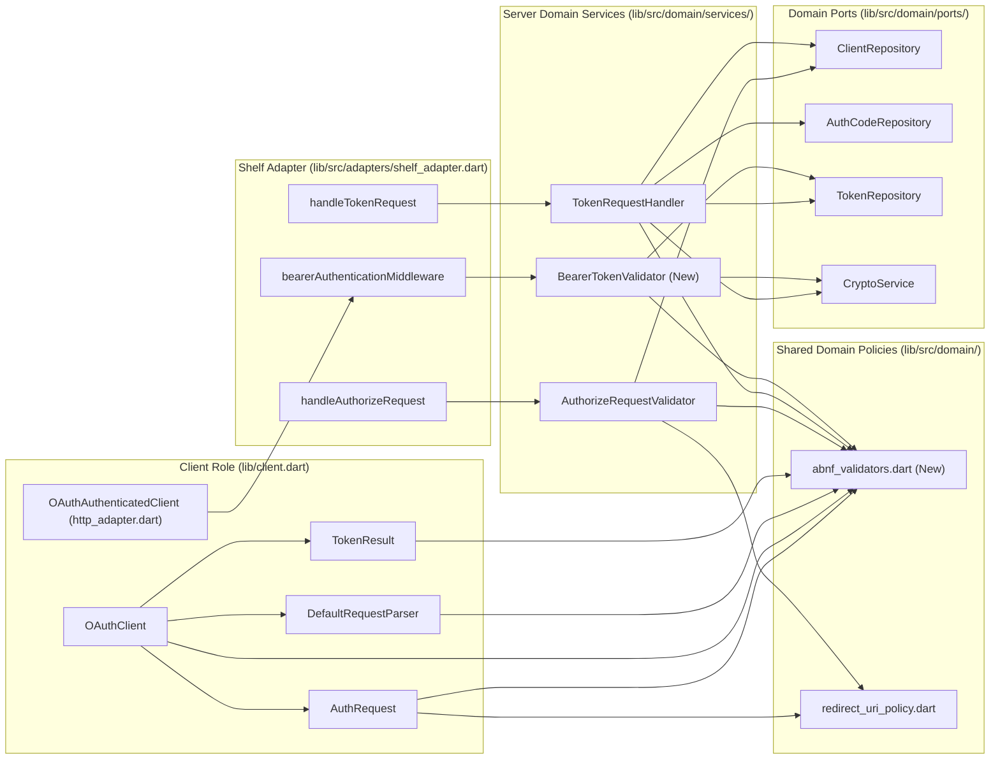

# OAuth 2.1 Protocol Hardening & Resource Server Verification

*   **Author:** mark-dropbear
*   **Status:** Approved
*   **Date:** 2026-11-05

--------------------------------------------------------------------------------

## Overview

The `oauth21` Dart package provides domain primitives, protocol validators, and HTTP/Shelf adapters for building OAuth 2.1 systems in Dart. A line-by-line audit of the library against `draft-ietf-oauth-v2-1-17.txt` identified eleven open specification compliance and security issues (`#2`–`#7` and `#9`–`#13`). This design covers closing all eleven gaps across the Client, Authorization Server, Resource Server, and Shelf adapter layers so greenfield Dart applications can implement all three OAuth 2.1 roles according to the specification.

## The Problem

Developers adopting `oauth21` for greenfield OAuth 2.1 deployments currently face four categories of failures:

1.  **Interoperability Failures Between Compliant OAuth 2.1 Clients and Servers:**
    *   `TokenRequestHandler` requires `redirect_uri` on every `authorization_code` token request (`#4`), even though OAuth 2.1 Section 4.1.3 and Section 10.2 removed `redirect_uri` from `/token` requests because mandatory `S256` PKCE binds the authorization code. As a result, `OAuthClient.exchangeCode` fails against `TokenRequestHandler` whenever the optional `redirectUri` parameter is omitted.
    *   `TokenRequestHandler` decodes HTTP Basic Authentication credentials with `Uri.decodeComponent` instead of `Uri.decodeQueryComponent` (`#2`), causing authentication to fail whenever a `client_id` or `client_secret` contains a space encoded as `+` by `OAuthClient`, and crashes with an unhandled `ArgumentError` on malformed percent-encoding.
    *   `AuthorizeRequestValidator`, `AuthRequest`, and `shelf_adapter.dart` require a non-empty `state` parameter on every authorization request (`#5`), rejecting compliant OAuth 2.1 clients that rely on PKCE for CSRF protection and omit the optional `state` parameter.
    *   Parameters sent with an empty value (such as `client_secret=` or `state=`) are treated as present rather than omitted (`#13`), violating Sections 3.1 and 3.2 and breaking public client token exchanges.
2.  **Unmitigated Security Vulnerabilities on the Authorization Server:**
    *   `AuthorizeRequestValidator._isRedirectUriAllowed` normalizes paths via `.normalizePath()` before comparing URIs while returning the un-normalized URI for redirection (`#10`). An attacker can supply `https://client.example/open-redirect/../cb` to bypass validation against `https://client.example/cb` and trigger an open redirect.
    *   `TokenRequestHandler._handleRefreshToken` resets `expiresAt` to 30 days from the current time on every refresh token rotation (`#11`), violating Section 9.3.2 and allowing a refresh token chain to outlive its initial grant indefinitely.
    *   `handleAuthorizeRequest` in `shelf_adapter.dart` omits the mandatory `iss` parameter on authorization error redirects (`#12`), weakening mix-up attack defenses (Section 4.1.2.1), and `AuthorizeRequestValidator` never checks `client.allowedGrantTypes.contains('authorization_code')`.
3.  **Incomplete Input & Response Validation Across Client and Server:**
    *   The server token endpoint does not validate `code_verifier` against the 43–128 character unreserved ASCII ABNF before checking code reuse (`#3`), does not deduplicate scope tokens (`#6`), and does not validate `VSCHAR` syntax on `client_id`, `client_secret`, `code`, and `refresh_token` (`#13`).
    *   On the client, `TokenResult.fromResponse` ignores HTTP status codes and casts `refresh_token` and `scope` with `as String?` (`#7`), throwing an unhandled `TypeError` instead of `FormatException` when a server returns non-string JSON values. `OAuthClient` also lacks `exchangeClientCredentials` and the optional `scope` parameter on `exchangeRefreshToken`.
4.  **Missing Resource Server Role Support:**
    *   While `TokenRepository` stores hashed `AccessToken` records, the package provides no domain validator or Shelf middleware to verify incoming `Authorization: Bearer <token>` requests, check token expiration/revocation/scopes, ignore URI query tokens per Section 5.1, or return RFC-compliant `WWW-Authenticate: Bearer` headers (`#9`).

## Goals

*   **Close Authorization Endpoint & Redirect URI Security Gaps (`#5`, `#10`, `#12`, `#13`):** Enforce exact un-normalized `redirect_uri` matching without dot-segments or reserved query keys, verify `client.allowedGrantTypes` and HTTP `GET` at `/authorize`, include mandatory `iss` on all authorization error redirects, and make `state` optional per OAuth 2.1 Section 4.1.1.
*   **Close Token Endpoint Protocol & Lifetime Bugs (`#2`, `#3`, `#4`, `#6`, `#11`, `#13`):** Fix HTTP Basic Authentication decoding (`Uri.decodeQueryComponent`, case-insensitive `Basic` scheme, `WWW-Authenticate: Basic` on `401`, conflicting `client_id` rejection), validate `code_verifier` ABNF (43–128 chars) before code reuse checks, remove the mandatory `redirect_uri` requirement at `/token`, deduplicate and validate `scope` tokens, and preserve `oldRefreshToken.expiresAt` across refresh token rotations.
*   **Harden Client Flows & Response Parsing (`#5`, `#7`, `#13`):** Add `exchangeClientCredentials({String? scope})` and `exchangeRefreshToken(refreshToken, {String? scope})` to `OAuthClient`, validate HTTP status codes and field types/ABNF in `TokenResult.fromResponse` (throwing `FormatException` rather than `TypeError`), and harden `DefaultRequestParser` against ambiguous `code` + `error` callbacks.
*   **Deliver OAuth 2.1 Resource Server Verification (`#9`):** Provide a `BearerTokenValidator` domain service and `bearerAuthenticationMiddleware` Shelf middleware enforcing Section 5 (`Authorization: Bearer` header parsing, ignoring URI query tokens, validating `token68` syntax, checking token validity and required scopes, and returning `400`/`401`/`403` with `WWW-Authenticate: Bearer` challenges).

## Non-Goals

*   **OAuth 2.0 Legacy Modes:** Supporting OAuth 2.0 behavior removed in OAuth 2.1 (such as conditional `redirect_uri` tracking from `/authorize` to `/token`, `response_type=token`, password grant, or PKCE `plain`).
*   **Self-Encoded JWT Access Tokens or Remote Introspection:** Implementing JSON Web Tokens (RFC 9068), Token Introspection (RFC 7662), or DPoP (RFC 9449). Resource Server validation in this design uses opaque reference tokens backed by `TokenRepository` and `CryptoService`.
*   **IPv4 `127.0.0.0/8` Subnet Expansion (`#8`):** Expanding loopback host checks beyond `127.0.0.1`, `::1`, `[::1]`, and `localhost`, as `draft-ietf-oauth-v2-1-17.txt` Section 8.4.2 specifies `127.0.0.1` and `[::1]`.
*   **Form-Encoded Body Token Extraction in Shelf Middleware:** Reading `application/x-www-form-urlencoded` request bodies inside `bearerAuthenticationMiddleware` to look for `access_token`, because Section 5.1.2 marks form-encoded bearer tokens as `SHOULD NOT` for clients and `MAY` for servers, and reading Shelf's single-subscription request stream in middleware breaks downstream handlers.

## Open Questions

*   None. All specification boundaries and architectural decisions were resolved during the brainstorming and design review phases.

## Critical User Journeys (CUJs)

### CUJ 1: Pure OAuth 2.1 Authorization Code Exchange Without `redirect_uri` or `state`

*   **Given**: A public or confidential client registered with `allowedGrantTypes: {'authorization_code', 'refresh_token'}` and `https://app.example.com/cb`.
*   **When**: The client initiates `/authorize` with PKCE `S256` (`code_challenge`) and no `state`, receives the redirect containing `code` and `iss` (with no `state` parameter), and calls `OAuthClient.exchangeCode(code: code, codeVerifier: verifier)` without sending `redirect_uri` to `/token`.
*   **Then**: `TokenRequestHandler` validates the 43–128 character `code_verifier` against the stored `code_challenge`, consumes the authorization code, and returns `200 OK` with an access token and refresh token.

### CUJ 2: Refresh Token Rotation Preserving Initial Grant Expiration

*   **Given**: A client holds a valid refresh token issued at $T_0$ with `expiresAt` set to $T_0 + 30\text{ days}$ and `scope: "read write"`.
*   **When**: At $T_0 + 10\text{ days}$, the client calls `OAuthClient.exchangeRefreshToken(refreshToken, scope: "read read")`.
*   **Then**: `TokenRequestHandler` validates the scope syntax, deduplicates `"read read"` to `"read"`, rotates the refresh token, and issues a new `RefreshToken` whose `expiresAt` remains $T_0 + 30\text{ days}$ (not $T_0 + 40\text{ days}$).

### CUJ 3: Resource Server Protecting a Shelf Endpoint with Bearer Authentication

*   **Given**: A Shelf route wrapped with `bearerAuthenticationMiddleware(validator: validator, requiredScopes: {'read'}, isHttps: true)`.
*   **When**:
    1. A client sends `GET /resource?access_token=ignored` with no `Authorization` header.
    2. A client sends `GET /resource` with an expired or revoked Bearer token.
    3. A client sends `GET /resource` with a valid Bearer token that only has `scope: "profile"`.
    4. A client sends `GET /resource` with a valid Bearer token that has `scope: "read profile"`.
*   **Then**:
    1. Request 1 ignores the query parameter token and receives `401 Unauthorized` with `WWW-Authenticate: Bearer` (and no `error` attribute).
    2. Request 2 receives `401 Unauthorized` with `WWW-Authenticate: Bearer error="invalid_token", ...`.
    3. Request 3 receives `403 Forbidden` with `WWW-Authenticate: Bearer error="insufficient_scope", scope="read", ...`.
    4. Request 4 succeeds (`200 OK`), and the route handler retrieves the validated `AccessToken` via `getAccessTokenFromContext(request)`.

## Technical Plan (Architecture)

The library follows a hexagonal (ports and adapters) architecture: pure protocol logic lives in `lib/src/domain/` (`entities/`, `value_objects/`, `ports/`, `services/`), while HTTP wire parsing and framework integration live in `lib/src/adapters/` ([`http_adapter.dart`](file:///home/mark/Code/oauth21/lib/src/adapters/http_adapter.dart) and [`shelf_adapter.dart`](file:///home/mark/Code/oauth21/lib/src/adapters/shelf_adapter.dart)). Shared OAuth 2.1 Appendix A ABNF syntax rules and URI security policies are centralized in internal domain modules (`abnf_validators.dart` and [`redirect_uri_policy.dart`](file:///home/mark/Code/oauth21/lib/src/domain/redirect_uri_policy.dart)) so client and server components enforce identical grammar constraints without duplicating regular expressions.



### 1. Redirect URI Policy & Authorization Endpoint (`#5`, `#10`, `#12`, `#13`)

1.  **Strict Un-Normalized Redirect URI Validation (`redirect_uri_policy.dart` & `AuthorizeRequestValidator` — `#10`):**
    *   `isAllowedRedirectUri` rejects any URI containing `.` or `..` path segments, duplicate query parameter keys, reserved OAuth 2.1 authorization response parameter names (`code`, `state`, `iss`, `error`, `error_description`, `error_uri` per Section 2.3), or malformed percent-encoding in the query string.
    *   `AuthorizeRequestValidator` compares non-loopback redirect URIs using exact character-by-character string comparison without path normalization (Section 4.1.1), and compares `http` loopback URIs (`localhost`, `127.0.0.1`, `::1`, `[::1]`) by scheme, lowercase host, exact path, and exact query while allowing dynamic port numbers (Section 8.4.2).
2.  **Empty Parameter Normalization, `allowedGrantTypes` Check, and Optional `state` (`AuthorizeRequestValidator` — `#5`, `#12`, `#13`):**
    *   Single empty parameter values (`key=`) are treated as omitted per Section 3.1 after verifying no parameter key is duplicated (`values.length > 1`), without mutating the caller's input map.
    *   `state` is optional per Section 4.1.1; when present, it must match `1*VSCHAR` without leading/trailing whitespace.
    *   `AuthorizeRequestValidator` verifies that the client registration includes `'authorization_code'` in `allowedGrantTypes` (returning `unauthorized_client` otherwise) and returns `invalid_scope` when `scope` syntax is malformed (Section 4.1.2.1).
3.  **Shelf Authorization Adapter (`shelf_adapter.dart` — `#5`, `#12`):**
    *   `handleAuthorizeRequest` enforces HTTP `GET` (`405 Method Not Allowed` with `Allow: GET`) and appends the mandatory `iss` parameter to all redirectable error responses (Section 4.1.2.1).
    *   `redirectWithAuthorizationCode` includes `state` only when non-null and non-empty, and `redirectWithAuthorizationError` provides a symmetric helper for application-level authorization errors (such as user consent denial `access_denied`).

### 2. Server Token Endpoint Hardening (`#2`, `#3`, `#4`, `#6`, `#11`, `#13`)

```text
POST /token
  │
  ├─► 1. Transport Security: require isHttps == true (400 invalid_request)
  ├─► 2. Empty Parameter Normalization: construct filtered map omitting value == "" (Section 3.2)
  ├─► 3. Client Auth & Identification (#2, #13):
  │     ├─ If Authorization header present:
  │     │    ├─ Must start with case-insensitive "Basic " (else 401 + WWW-Authenticate: Basic)
  │     │    ├─ Base64-decode, split ':', require parts.length == 2 & parts[0].isNotEmpty
  │     │    ├─ Uri.decodeQueryComponent on parts[0] and parts[1] (catch FormatException & ArgumentError)
  │     │    └─ If body['client_id'] present and != Basic clientId -> 400 invalid_request
  │     ├─ Reject simultaneous Basic + body['client_secret'] -> 400 invalid_request
  │     ├─ Validate clientId (1*VSCHAR, trimmed) and clientSecret (*VSCHAR)
  │     │    └─ Basic header violation -> 401 invalid_client + WWW-Authenticate: Basic; body violation -> 400 invalid_request
  │     └─ Verify client registration & secret (401 invalid_client + WWW-Authenticate: Basic)
  └─► 4. Grant-Specific Validation:
        ├─ authorization_code (#3, #4, #13):
        │    ├─ Validate code (1*VSCHAR) and code_verifier (43-128 unreserved chars) -> 400 invalid_request
        │    ├─ Lookup AuthCode & verify client binding -> 400 invalid_grant
        │    ├─ If body['redirect_uri'] provided: require exact match with authCode.redirectUri -> 400 invalid_grant
        │    └─ Verify S256 PKCE challenge BEFORE checking authCode.isUsed (Section 7.5.3 DoS defense)
        ├─ client_credentials (#6):
        │    └─ Validate scope tokens (1*NQCHAR, no empty tokens -> 400 invalid_scope) & deduplicate
        └─ refresh_token (#6, #11, #13):
             ├─ Validate refresh_token (1*VSCHAR -> 400 invalid_request)
             ├─ Validate scope tokens (1*NQCHAR, subset of original, deduplicate -> 400 invalid_scope)
             └─ Rotate refresh token preserving oldRefreshToken.expiresAt (Section 9.3.2)
```

### 3. Client Hardening & Callback Parsing (`#5`, `#7`, `#13`)

1.  **Optional `state` on Client (`AuthRequest` & `OAuthClient` — `#5`):**
    *   `AuthRequest` and `OAuthClient.createAuthorizationRequest` make `state` optional (`String? state`).
    *   `OAuthClient.validateCallback` verifies `params.state == expectedState` when `expectedState` is provided, and rejects unsolicited `params.state != null` with `StateError` when `expectedState` is omitted.
2.  **Callback Parser Hardening (`DefaultRequestParser` — `#13`):**
    *   `OAuthRedirectParameters` adds `errorUri`, and `DefaultRequestParser.parseRedirect` rejects callbacks containing both `code` and `error` (`ArgumentError`) and validates `iss` (`1*VSCHAR`) and `error_uri` (`1*NQCHAR` and valid URI reference) via `FormatException`.
3.  **`TokenResult.fromResponse` & `OAuthClient` Grants (`#7`):**
    *   `TokenResult.fromResponse` validates HTTP status codes (`200` for success, `>= 400` for error responses when `statusCode` is supplied) and validates `access_token` (`1*VSCHAR`), `expires_in` (positive JSON `int`), `refresh_token` (`1*VSCHAR`), and `scope` (`1*NQCHAR` space-delimited tokens), throwing `FormatException` on any malformed value or type mismatch.
    *   `OAuthClient` adds `exchangeClientCredentials({String? scope})` for confidential clients and adds optional `{String? scope}` to `exchangeRefreshToken`.

### 4. Resource Server Bearer Token Verification & Shelf Middleware (`#9`)

1.  **Domain Service (`BearerTokenValidator`):**
    *   Validates incoming Resource Server requests per OAuth 2.1 Section 5: requires HTTPS (`400 invalid_request`), ignores URI query parameters (Section 5.1), rejects multiple `Authorization` headers (`400 invalid_request` with `WWW-Authenticate: Bearer`), returns `401 Unauthorized` with bare `WWW-Authenticate: Bearer` when no `Bearer` header is present (Section 5.3.2), validates `token68` syntax and hashed token validity (`401 invalid_token`), and enforces required scopes (`403 insufficient_scope`).
2.  **Shelf Middleware (`bearerAuthenticationMiddleware`):**
    *   Extracts `request.headersAll['authorization']` without consuming the single-subscription `request.read()` body stream, delegates to `BearerTokenValidator`, returns the appropriate `400`/`401`/`403` `shelf.Response` with `WWW-Authenticate` headers on failure, or attaches the validated `AccessToken` to `request.context[oauthAccessTokenContextKey]` (retrievable via `getAccessTokenFromContext(request)`) on success.

## Alternatives Considered

### Alternative A: Track Conditional `redirect_uri` Between `/authorize` and `/token` (Original Issue `#4`)

*   **Pros**: Matches the OAuth 2.0 (RFC 6749 Section 4.1.3) state machine where `redirect_uri` is required at `/token` if and only if it was included in the `/authorize` request.
*   **Cons**: Requires adding state tracking (`wasRedirectUriExplicit`) to `AuthorizeValidationResult` and `AuthCode`, and rejects compliant OAuth 2.1 clients that send `redirect_uri` to `/authorize` (such as clients with multiple registered redirect URIs) and then omit `redirect_uri` at `/token` per OAuth 2.1 Section 4.1.3.
*   **Reason for Rejection**: OAuth 2.1 Section 4.1.3 and Section 10.2 explicitly removed `redirect_uri` from `/token` requests because mandatory `S256` PKCE prevents authorization code injection. Requiring `redirect_uri` at `/token` violates OAuth 2.1 and breaks interoperability with compliant OAuth 2.1 clients.

### Alternative B: Expand `isLoopbackHost` to Full `127.0.0.0/8` Subnet Range (Original Issue `#8`)

*   **Pros**: Allows native desktop applications on Linux or Windows to bind to alternate IPv4 loopback addresses such as `127.0.0.2` (as described in older RFC 8252 Section 7.3).
*   **Cons**:
    1. `draft-ietf-oauth-v2-1-17.txt` Section 8.4.2 (lines 4383–4384) narrowed the IPv4 loopback specification from RFC 8252's `127.0.0.0/8` to the single canonical IPv4 literal: *"That is, `http://127.0.0.1:{port}/{path}` for IPv4, and `http://[::1]:{port}/{path}` for IPv6."*
    2. Section 4.1.1 (lines 2212–2214) states that the **only** exception to exact character-by-character `redirect_uri` matching for loopback URIs is variable port numbers—not variable IPv4 addresses across `127.0.0.0/8`.
    3. On macOS, iOS, and BSD systems, only `127.0.0.1` is configured on the `lo0` loopback interface by default; `127.0.0.2`–`127.255.255.254` are unreachable without root interface aliasing, making non-`127.0.0.1` literals non-portable across desktop/mobile targets.
*   **Reason for Rejection**: `draft-ietf-oauth-v2-1-17.txt` Section 8.4.2 standardizes on `127.0.0.1` and `[::1]` with dynamic ephemeral ports, which is portable across all operating systems and aligns with Section 4.1.1's port-only matching exception.

### Alternative C: Return `400 Bad Request` When Resource Server Requests Include `?access_token=...` in URI Query (Original Issue `#9`)

*   **Pros**: Actively signals to callers that query-string bearer tokens are prohibited.
*   **Cons**: Directly violates `draft-ietf-oauth-v2-1-17.txt` Section 5.1 (lines 2792–2794), which mandates that *"resource servers MUST ignore access tokens in a URI query parameter"*, and allows an unrelated query parameter named `access_token` to break requests that carry a valid `Authorization: Bearer` header.
*   **Reason for Rejection**: Violates the normative `MUST ignore` requirement in Section 5.1.

### Alternative D: Parse `application/x-www-form-urlencoded` Request Bodies for `access_token` Inside Shelf Resource Server Middleware

*   **Pros**: Implements the optional Section 5.1.2 form-encoded body method inside `bearerAuthenticationMiddleware`.
*   **Cons**: In `package:shelf`, `Request.read()` is a single-subscription byte stream. Consuming the body stream inside authentication middleware exhausts the stream so downstream route handlers can no longer read the POST body unless the middleware buffers and reconstructs the entire request payload in memory on every form request.
*   **Reason for Rejection**: Section 5.1.2 states that form-encoded bearer tokens `SHOULD NOT` be used by clients and `MAY` be supported by resource servers, whereas Section 5.1.1 (`Authorization: Bearer` header) is `MUST` for resource servers. Restricting the Shelf middleware to header extraction avoids stream exhaustion and memory buffering overhead.

--------------------------------------------------------------------------------

## Non-Functional Requirements

*   **Security & Privacy**:
    *   **Open Redirect Prevention**: `AuthorizeRequestValidator` must never normalize path segments (`..` or `.`) when comparing `redirect_uri` values and must reject reserved OAuth response parameters in `redirect_uri` query strings (Sections 2.3 and 4.1.1).
    *   **DoS & Replay Protection (Section 7.5.3)**: `TokenRequestHandler._handleAuthorizationCode` must validate `code_verifier` ABNF and verify the `S256` PKCE challenge *before* checking `authCode.isUsed`, ensuring an attacker who intercepts an authorization code without the `code_verifier` cannot trigger token family revocation.
    *   **Bounded Refresh Token Lifetime (Section 9.3.2)**: Rotating a refresh token must never extend `expiresAt` beyond the initial refresh token's expiration timestamp.
    *   **Constant-Time & Hashed Token Storage**: `BearerTokenValidator` must hash incoming bearer tokens via `CryptoService.hashString` (SHA-256) before querying `TokenRepository.findAccessTokenByHash`, ensuring raw access tokens are never compared or stored in plaintext.
*   **Performance & Latency**:
    *   All OAuth 2.1 Appendix A ABNF regular expressions (`VSCHAR` `[\x20-\x7E]`, `NQCHAR` `[\x21\x23-\x5B\x5D-\x7E]`, `NQSCHAR` `[\x20-\x21\x23-\x5B\x5D-\x7E]`, `token68`, `code_verifier`) must be compiled once as `final RegExp` constants in `lib/src/domain/abnf_validators.dart` rather than recompiled on every request.
    *   `bearerAuthenticationMiddleware` must operate on request headers in $O(1)$ memory without reading or buffering the request body stream.

--------------------------------------------------------------------------------

## Additional Resources

*   Normative Specification: [`draft-ietf-oauth-v2-1-17.txt`](file:///home/mark/Code/oauth21/draft-ietf-oauth-v2-1-17.txt) (The OAuth 2.1 Authorization Framework, October 2026)
*   Brainstorm Artifact: [`concepts_brief.md`](file:///home/mark/Code/oauth21/concepts_brief.md)
*   GitHub Issues: `#2`–`#7` and `#9`–`#13`

## Future Improvements

*   **Token Introspection (RFC 7662) & JWT Access Tokens (RFC 9068)**: Add an optional port or adapter for standalone Resource Servers that validate tokens via remote introspection or local JWS verification rather than a shared `TokenRepository`.
*   **Sender-Constrained Tokens (DPoP — RFC 9449)**: Add proof-of-possession header validation alongside Bearer token support.

--------------------------------------------------------------------------------

## Detailed Implementation Plan

Work is partitioned into 4 incremental phases on a dedicated feature branch managed via a GitHub Pull Request. Each phase pairs production code changes with their corresponding unit/integration tests, ends with a full build and test verification checkpoint (`dart analyze --fatal-infos --fatal-warnings`, `dart format --output=none --set-exit-if-changed .`, `dart test`), and commits/closes the completed GitHub issues in topological dependency order.

---

### Phase 1: Shared ABNF Validators, Redirect URI Security, Callback Parser & Authorization Endpoint Hardening (Closes `#10`, `#12`, `#5`; Partial `#13`)

#### 1.1 `lib/src/domain/abnf_validators.dart` (Create — Shared Grammar Helpers)

*   **Type / Scope**: Internal Domain Grammar Validation Module
*   **Proposed Changes**:
    *   Define compiled `final RegExp` constants for OAuth 2.1 Appendix A grammar rules:
        *   `final RegExp vscharRequiredRegex = RegExp(r'^[\x20-\x7E]+$');` (`1*VSCHAR`)
        *   `final RegExp vscharOptionalRegex = RegExp(r'^[\x20-\x7E]*$');` (`*VSCHAR`)
        *   `final RegExp nqcharRequiredRegex = RegExp(r'^[\x21\x23-\x5B\x5D-\x7E]+$');` (`1*NQCHAR`)
        *   `final RegExp nqscharRequiredRegex = RegExp(r'^[\x20-\x21\x23-\x5B\x5D-\x7E]+$');` (`1*NQSCHAR`)
        *   `final RegExp codeVerifierAbnfRegex = RegExp(r'^[A-Za-z0-9\-._~]{43,128}$');` (`43*128unreserved`)
        *   `final RegExp token68Regex = RegExp(r'^[A-Za-z0-9\-._~+/]+=*$');` (`token68`)
    *   Define helper functions:
        *   `bool isValidVscharParam(String value)` -> returns `value.isNotEmpty && value.trim() == value && vscharRequiredRegex.hasMatch(value)`.
        *   `bool isValidScopeString(String scope, {bool allowEmpty = false})`: if `scope.isEmpty`, returns `allowEmpty`; splits on `' '` and returns `true` if every token is non-empty and matches `nqcharRequiredRegex`.
        *   `Set<String>? parseAndDeduplicateScope(String scope)`: returns `null` if `!isValidScopeString(scope)`, otherwise returns `scope.split(' ').toSet()`.
        *   `bool isValidErrorUri(String value)`: returns `value.isNotEmpty && nqcharRequiredRegex.hasMatch(value) && (Uri.tryParse(value)?.hasScheme ?? false)`.
*   **Rationale**: Eliminates six-way regex and scope-validation duplication across client and server domain files.

#### 1.2 [`lib/src/domain/redirect_uri_policy.dart`](file:///home/mark/Code/oauth21/lib/src/domain/redirect_uri_policy.dart) (Modify — Issue `#10`)

*   **Type / Scope**: Domain URI Security Policy
*   **Proposed Changes**:
    *   Define `const Set<String> _reservedAuthorizationResponseKeys = {'code', 'state', 'iss', 'error', 'error_description', 'error_uri'};`.
    *   In `isAllowedRedirectUri(Uri uri)`:
        *   Return `false` if `uri.pathSegments.any((segment) => segment == '.' || segment == '..')` to prevent dot-segment path-traversal open redirects.
        *   Wrap `uri.queryParametersAll` inspection in `try { ... } on Object catch (_) { return false; }` so malformed percent-encoding in query strings returns `false` instead of throwing `FormatException` or `ArgumentError`.
        *   Inside the `try` block, return `false` if any entry in `uri.queryParametersAll.entries` has `entry.value.length > 1` (duplicate query parameter keys) or `_reservedAuthorizationResponseKeys.contains(entry.key)` (Section 2.3).
*   **Rationale**: Prevents path-traversal open-redirect attacks, rejects reserved OAuth response query keys, and guards against malformed percent-encoding crashes.

#### 1.3 [`lib/src/domain/services/authorize_request_validator.dart`](file:///home/mark/Code/oauth21/lib/src/domain/services/authorize_request_validator.dart) (Modify — Issues `#5`, `#10`, `#12`, `#13`)

*   **Type / Scope**: Server Domain Authorization Endpoint Validator
*   **Proposed Changes**:
    *   Add a non-mutating private helper `String? _singleNonEmptyValue(List<String>? values)` that returns `null` when `values == null || values.isEmpty || (values.length == 1 && values.first.isEmpty)`, and returns `values.first` when `values.length == 1`.
    *   Preserve the 3-stage validation order in `validate(Map<String, List<String>> params)` without mutating `params`:
        1. **Stage A (`client_id` & `redirect_uri`, non-redirectable on failure)**:
           * Verify `(params['client_id']?.length ?? 0) <= 1` and `(params['redirect_uri']?.length ?? 0) <= 1` (returning non-redirectable `invalid_request` if `> 1`).
           * Extract `clientId = _singleNonEmptyValue(params['client_id'])` and `redirectUriRaw = _singleNonEmptyValue(params['redirect_uri'])` (treating `key=` as omitted per Section 3.1).
           * Validate `clientId` (`isValidVscharParam`), look up `client`, and validate `redirect_uri`.
        2. **Stage B (`state`, redirectable without `state` on failure)**:
           * Verify `(params['state']?.length ?? 0) <= 1`; if `> 1`, return redirectable `invalid_request` with `state: null`.
           * Extract `state = _singleNonEmptyValue(params['state'])`. When `state != null`, validate `isValidVscharParam(state)` (returning redirectable `invalid_request` with `state: null` on failure). When `state == null`, allow omitted `state` per Section 4.1.1.
        3. **Stage C (Remaining parameters, `allowedGrantTypes`, PKCE & `scope`, redirectable with `state` on failure)**:
           * Check all entries in `params.entries` for `entry.value.length > 1` (returning redirectable `invalid_request` with `state: state`).
           * Check `if (!client.allowedGrantTypes.contains('authorization_code'))` and return redirectable `AuthorizeValidationResult.invalid` with `errorCode: 'unauthorized_client'` and `state: state` (Section 4.1.2.1).
           * Extract `response_type`, `code_challenge`, `code_challenge_method`, and `scope` via `_singleNonEmptyValue`.
           * Validate `scope` using `parseAndDeduplicateScope(scope)` from `abnf_validators.dart`; if invalid, return redirectable `AuthorizeValidationResult.invalid` with `errorCode: 'invalid_scope'` (Section 4.1.2.1 line 2363).
    *   In `_isRedirectUriAllowed(ClientRegistration client, Uri requestedUri)` and `_matchLoopback(Uri registered, Uri requested)`:
        *   Remove all `.normalizePath()` calls.
        *   Require exact string equality `registeredUri.toString() == requestedUri.toString()` for non-loopback URIs (Section 4.1.1).
        *   For `http` loopback URIs, compare `scheme == 'http'`, `registered.host.toLowerCase() == requested.host.toLowerCase()`, `registered.path == requested.path`, and `registered.query == requested.query` (allowing only the port to vary per Section 8.4.2).
*   **Rationale**: Enforces Section 4.1.1 exact URI comparison, Section 4.1.2.1 `unauthorized_client` and `invalid_scope` rules, Section 3.1 non-mutating empty-value normalization, and Section 4.1.1 optional `state`.

#### 1.4 [`lib/src/domain/entities/auth_request.dart`](file:///home/mark/Code/oauth21/lib/src/domain/entities/auth_request.dart) (Modify — Issue `#5`)

*   **Type / Scope**: Client Domain Authorization Request Entity
*   **Proposed Changes**:
    *   Change `final String state;` to `final String? state;` and make `this.state` optional in `AuthRequest(...)`.
    *   When `state != null`, validate `vscharRequiredRegex.hasMatch(state)` (throwing `ArgumentError` if empty or invalid) and include `'state'` in `standardKeysToAdd` and `if (state != null) queryParams['state'] = state!;` in `toUri()`.
*   **Rationale**: Allows OAuth 2.1 clients to omit `state` when relying on PKCE `S256` per Section 4.1.1.

#### 1.5 [`lib/src/domain/ports/oauth_req_parser.dart`](file:///home/mark/Code/oauth21/lib/src/domain/ports/oauth_req_parser.dart) (Modify — Issue `#13`)

*   **Type / Scope**: Client Redirect Callback Parser Port & Default Implementation
*   **Proposed Changes**:
    *   Add `final String? errorUri;` to `OAuthRedirectParameters`.
    *   In `DefaultRequestParser.parseRedirect(Uri redirectUrl)`:
        *   Throw `ArgumentError` if `code != null && error != null`.
        *   When `iss != null`, validate `vscharRequiredRegex.hasMatch(iss)` (throwing `FormatException` on failure).
        *   Extract `final errorUri = queryParams['error_uri'];` and when `errorUri != null`, validate `isValidErrorUri(errorUri)` (throwing `FormatException` on failure).
*   **Rationale**: Prevents ambiguous callback responses containing both `code` and `error` and validates `iss` and `error_uri` per Section 4.1.2.1.

#### 1.6 [`lib/src/domain/oauth_client.dart`](file:///home/mark/Code/oauth21/lib/src/domain/oauth_client.dart) (Modify — Issue `#5` Part)

*   **Type / Scope**: Client Orchestrator Service
*   **Proposed Changes**:
    *   Make `String? state` optional in `createAuthorizationRequest`.
    *   Make `String? expectedState` optional in `validateCallback(OAuthRedirectParameters params, {String? expectedState})`:
        *   When `expectedState != null`: throw `StateError` if `params.state == null || params.state != expectedState`.
        *   When `expectedState == null`: throw `StateError` if `params.state != null` (rejecting unsolicited state injection).
*   **Rationale**: Completes optional `state` support in the client authorization flow.

#### 1.7 [`lib/src/adapters/shelf_adapter.dart`](file:///home/mark/Code/oauth21/lib/src/adapters/shelf_adapter.dart) (Modify — Issues `#5`, `#12`)

*   **Type / Scope**: Server Shelf HTTP Adapter (Authorization Endpoint Helpers)
*   **Proposed Changes**:
    *   In `handleAuthorizeRequest`:
        *   Add `required String issuer` parameter.
        *   Check `if (request.method != 'GET')` and return `shelf.Response(405, headers: {'Allow': 'GET', 'Content-Type': 'application/json', 'Cache-Control': 'no-store', 'Pragma': 'no-cache'}, body: jsonEncode({'error': 'invalid_request', 'error_description': 'HTTP method must be GET.'}))`.
        *   Include `'iss': issuer` in the query parameters of redirectable error responses.
    *   In `redirectWithAuthorizationCode`:
        *   Change `required String state` to `String? state` and include `if (state != null && state.isNotEmpty) 'state': state` in the redirect query parameters.
    *   Add `shelf.Response redirectWithAuthorizationError({required Uri redirectUri, required String error, required String issuer, String? errorDescription, String? state})` that builds a `302 Found` redirect with `error`, optional `error_description`, optional `state` (when non-null and non-empty), and mandatory `iss`, plus `Cache-Control: no-store` and `Pragma: no-cache`.
*   **Rationale**: Enforces mandatory `iss` on error redirects, optional `state` on success redirects, and HTTP `GET` on `/authorize`.

#### 1.8 Phase 1 Unit & Integration Test Updates

*   Update [`test/domain/services/authorize_request_validator_test.dart`](file:///home/mark/Code/oauth21/test/domain/services/authorize_request_validator_test.dart) (`#5`, `#10`, `#12`, `#13`): test omitted `state` and `state=` succeeding, malformed `scope` returning `'invalid_scope'`, path-traversal `redirect_uri` (`https://example.com/evil/../cb`) failing, reserved query keys (`?code=123`) and malformed percent-encoding (`?foo=%ZZ`) failing, `unauthorized_client` when `authorization_code` is not in `client.allowedGrantTypes`, and non-mutating empty-value normalization on `Map.unmodifiable`.
*   Update [`test/domain/entities/auth_request_test.dart`](file:///home/mark/Code/oauth21/test/domain/entities/auth_request_test.dart) (`#5`, `#10`): test `AuthRequest` with `state: null`, empty `state: ''` throwing `ArgumentError`, dot-segment `redirectUri` rejection, and reserved query parameter rejection.
*   Update [`test/domain/ports/oauth_req_parser_test.dart`](file:///home/mark/Code/oauth21/test/domain/ports/oauth_req_parser_test.dart) (`#13`): test `error_uri` parsing and `FormatException` on invalid `error_uri` or non-VSCHAR `iss`, and `ArgumentError` when both `code` and `error` are present.
*   Update [`test/domain/oauth_client_test.dart`](file:///home/mark/Code/oauth21/test/domain/oauth_client_test.dart) (`#5`): test `createAuthorizationRequest` and `validateCallback` with omitted `state` (including rejecting unsolicited `params.state`).
*   Update [`test/adapters/shelf_adapter_test.dart`](file:///home/mark/Code/oauth21/test/adapters/shelf_adapter_test.dart) and [`test/oauth21_test.dart`](file:///home/mark/Code/oauth21/test/oauth21_test.dart) (`#5`, `#12`): pass `issuer` to `handleAuthorizeRequest`, verify `iss` on error redirects, verify `405` on `POST /authorize`, and test `redirectWithAuthorizationCode(state: null)` and `redirectWithAuthorizationError`.
*   **Phase 1 Checkpoint**: Run `dart analyze --fatal-infos --fatal-warnings`, `dart format --output=none --set-exit-if-changed .`, and `dart test`. Commit to branch and close GitHub issues **`#10`**, **`#12`**, and **`#5`**.

---

### Phase 2: Server Token Endpoint Hardening & Refresh Token Rotation Lifetime (Closes `#13`, `#2`, `#3`, `#4`, `#6`, `#11`)

#### 2.1 [`lib/src/domain/services/token_request_handler.dart`](file:///home/mark/Code/oauth21/lib/src/domain/services/token_request_handler.dart) (Modify — Issues `#2`, `#3`, `#4`, `#6`, `#11`, `#13`)

*   **Type / Scope**: Server Domain Token Endpoint Handler
*   **Proposed Changes**:
    *   Define `static const _unauthorizedHeaders = {..._headers, 'WWW-Authenticate': 'Basic'};` and return `_unauthorizedHeaders` on all `statusCode: 401` responses.
    *   At the start of `handle(Map<String, String> body, ...)`, construct a new filtered map without mutating the caller's map: `body = {for (final entry in body.entries) if (entry.value.isNotEmpty) entry.key: entry.value};` (Section 3.2 line 1638).
    *   In Basic Auth parsing:
        *   If `authorizationHeader != null && authorizationHeader.trim().isNotEmpty`:
            *   Verify `authorizationHeader` starts with case-insensitive `Basic ` (`RegExp(r'^[Bb][Aa][Ss][Ii][Cc]\s+')`); otherwise return `401 invalid_client` with `_unauthorizedHeaders`.
            *   Base64-decode and UTF-8 decode inside `try { ... } on Object catch (_)`, require `parts.length == 2 && parts[0].isNotEmpty`, and decode `clientId = Uri.decodeQueryComponent(parts[0])` and `clientSecret = Uri.decodeQueryComponent(parts[1])`. If `parts.length != 2`, `parts[0].isEmpty`, or decoding throws `FormatException` or `ArgumentError`, return `401 invalid_client` with `_unauthorizedHeaders`.
            *   If `body['client_id'] != null && body['client_id'] != clientId`, return `400 invalid_request`.
    *   Validate `clientId` (`isValidVscharParam(clientId)`) and `clientSecret` (`vscharOptionalRegex.hasMatch(clientSecret)` when present); return `401 invalid_client` with `_unauthorizedHeaders` (if credentials came from the Basic header) or `400 invalid_request` (if `client_id` came from `body`) on violation.
    *   In `_handleAuthorizationCode`:
        *   Validate `isValidVscharParam(code)` and `codeVerifierAbnfRegex.hasMatch(codeVerifier)`, returning `400 invalid_request` on failure **before** looking up or consuming `authCode`.
        *   Make `redirect_uri` optional: if `body['redirect_uri']` is null (omitted or empty string normalized), do not require it. If `body['redirect_uri']` is present, require exact string equality `body['redirect_uri'] == authCode.redirectUri.toString()`, returning `400 invalid_grant` on mismatch.
    *   In `_handleClientCredentials` and `_handleRefreshToken`:
        *   In `_handleRefreshToken`, validate `isValidVscharParam(refreshTokenValue)` (`400 invalid_request`).
        *   Validate `requestedScope` using `parseAndDeduplicateScope(requestedScope)` from `abnf_validators.dart` (returning `400 invalid_scope` if null), check allowed/granted scope membership (`400 invalid_scope`), and join the deduplicated `Set<String>` with `' '`.
    *   In `_buildTokenPair` and `_handleRefreshToken`:
        *   Add `DateTime? refreshExpiresAt` parameter to `_buildTokenPair`.
        *   In `_handleRefreshToken`, pass `refreshExpiresAt: oldRefreshToken.expiresAt` so rotated refresh tokens preserve the initial refresh token's expiration timestamp (Section 9.3.2).
*   **Rationale**: Resolves all `/token` specification bugs (`#2`, `#3`, `#4`, `#6`, `#11`, `#13`).

#### 2.2 [`test/domain/services/token_request_handler_test.dart`](file:///home/mark/Code/oauth21/test/domain/services/token_request_handler_test.dart) (Modify — Issues `#2`, `#3`, `#4`, `#6`, `#11`, `#13`)

*   **Type / Scope**: Unit Tests
*   **Proposed Changes**:
    *   Update the two PKCE wrong-verifier test strings (lines 506 and 604) to 43+ character unreserved strings so they test hash mismatch (`invalid_grant`), and add dedicated tests for `<43`, `>128`, and non-ABNF `code_verifier` values returning `400 invalid_request` without revoking the authorization code.
    *   Update the omitted `redirect_uri` test (line 537) to expect `200 OK`, while keeping the mismatched `redirect_uri` test expecting `400 invalid_grant`.
    *   Add tests for Basic Auth `+`/space decoding (`Uri.decodeQueryComponent`), malformed `%` sequences (`ArgumentError` handling), `parts.length != 2`, non-Basic `Authorization` headers, `WWW-Authenticate: Basic` on all `401` responses, conflicting `body['client_id']`, empty `client_secret=` normalization on `Map.unmodifiable`, scope ABNF/deduplication, `VSCHAR` checks, and refresh token rotation preserving `oldRefreshToken.expiresAt`.
*   **Phase 2 Checkpoint**: Run `dart analyze --fatal-infos --fatal-warnings`, `dart format --output=none --set-exit-if-changed .`, and `dart test`. Commit to branch and close GitHub issues **`#13`**, **`#2`**, **`#3`**, **`#4`**, **`#6`**, and **`#11`**.

---

### Phase 3: Client Grants & Token Response Validation Hardening (Closes `#7`)

#### 3.1 [`lib/src/domain/entities/token_result.dart`](file:///home/mark/Code/oauth21/lib/src/domain/entities/token_result.dart) (Modify — Issue `#7`)

*   **Type / Scope**: Client Domain Token Endpoint Result Entity
*   **Proposed Changes**:
    *   Add `int? statusCode` to `TokenResult.fromResponse({required String body, required Map<String, String> headers, int? statusCode})`.
    *   When `statusCode != null`: throw `FormatException` if `json.containsKey('error') && statusCode < 400`, or if `!json.containsKey('error') && statusCode != 200`.
    *   Validate `access_token` is a `String` matching `vscharRequiredRegex` (`FormatException`).
    *   Validate `expires_in` (when present and non-null) is an `int` with `exp > 0`, throwing `FormatException` otherwise.
    *   Validate `refresh_token` (when present and non-null) is a `String` matching `vscharRequiredRegex`, throwing `FormatException` instead of `TypeError`.
    *   Validate `scope` (when present and non-null) is a `String` satisfying `isValidScopeString(scope, allowEmpty: true)`, throwing `FormatException` instead of `TypeError`.
*   **Rationale**: Hardens client response parsing against malformed JSON types, non-ABNF tokens, and mismatched HTTP status codes.

#### 3.2 [`lib/src/domain/oauth_client.dart`](file:///home/mark/Code/oauth21/lib/src/domain/oauth_client.dart) (Modify — Issue `#7`)

*   **Type / Scope**: Client Orchestrator Service
*   **Proposed Changes**:
    *   Extract a private `Map<String, String> _buildTokenRequestHeaders()` helper that constructs `{'Content-Type': 'application/x-www-form-urlencoded', 'Accept': 'application/json'}` and adds the HTTP Basic `Authorization` header when `clientSecret != null && clientSecret!.isNotEmpty`, reusing it across `exchangeCode`, `exchangeRefreshToken`, and `exchangeClientCredentials`.
    *   Update `exchangeRefreshToken(String refreshToken, {String? scope})`:
        *   Throw `ArgumentError` if `!isValidVscharParam(refreshToken)` or if `scope != null && !isValidScopeString(scope)`.
        *   Include `'scope': scope` in `body` when `scope != null`.
        *   Pass `statusCode: response.statusCode` to `TokenResult.fromResponse`.
    *   Add `Future<TokenResult> exchangeClientCredentials({String? scope})`:
        *   Throw `StateError` if `clientSecret == null || clientSecret!.isEmpty` (Section 4.2: Client Credentials grant is restricted to confidential clients).
        *   Throw `ArgumentError` if `scope != null && !isValidScopeString(scope)`.
        *   Send `POST` with `{'grant_type': 'client_credentials', if (scope != null) 'scope': scope}` and `_buildTokenRequestHeaders()`, and pass `statusCode: response.statusCode` to `TokenResult.fromResponse`.
    *   Pass `statusCode: response.statusCode` to `TokenResult.fromResponse` in `exchangeCode`.
*   **Rationale**: Completes OAuth 2.1 client support for refresh token scope narrowing and the `client_credentials` grant while removing duplicated Basic Auth header construction.

#### 3.3 Phase 3 Unit Test Updates

*   Update [`test/domain/entities/token_result_test.dart`](file:///home/mark/Code/oauth21/test/domain/entities/token_result_test.dart) (`#7`): update the string `"3600"` `expires_in` test to expect `FormatException` (per Section 3.2.3 requiring a JSON number), and add tests for `expires_in <= 0`, non-String `refresh_token` and `scope` throwing `FormatException` (not `TypeError`), non-ABNF `access_token`/`refresh_token`/`scope`, and `statusCode` mismatch checks.
*   Update [`test/domain/oauth_client_test.dart`](file:///home/mark/Code/oauth21/test/domain/oauth_client_test.dart) (`#7`): add tests for `exchangeRefreshToken` with valid/invalid `scope` and invalid `refreshToken` (`ArgumentError`), and `exchangeClientCredentials` (confidential client success, scope narrowing, invalid `scope` `ArgumentError`, and public client `StateError`).
*   **Phase 3 Checkpoint**: Run `dart analyze --fatal-infos --fatal-warnings`, `dart format --output=none --set-exit-if-changed .`, and `dart test`. Commit to branch and close GitHub issue **`#7`**.

---

### Phase 4: Resource Server Bearer Token Verification & Shelf Middleware (Closes `#9`)

#### 4.1 `lib/src/domain/services/bearer_token_validator.dart` (Create — Issue `#9`)

*   **Type / Scope**: Server Domain Resource Server Validator
*   **Proposed Changes**:
    *   Create `BearerValidationResult`:
        *   Fields: `final bool isValid`, `final int statusCode`, `final AccessToken? accessToken`, `final String? errorCode`, `final String? errorDescription`, and `final Map<String, String> headers`.
        *   Constructors:
            *   `const BearerValidationResult.valid(AccessToken this.accessToken) : isValid = true, statusCode = 200, errorCode = null, errorDescription = null, headers = const {};`
            *   `const BearerValidationResult.invalid({required this.statusCode, required this.headers, this.errorCode, this.errorDescription}) : isValid = false, accessToken = null;`
    *   Create `BearerTokenValidator`:
        *   Constructor: `const BearerTokenValidator({required this.tokenRepository, required this.cryptoService, this.realm});`.
        *   Method: `Future<BearerValidationResult> validate({String? authorizationHeader, List<String>? authorizationHeaders, Set<String> requiredScopes = const {}, bool isHttps = false})`.
        *   Private helper `String _buildWwwAuthenticate({String? errorCode, String? errorDescription, String? scope})`:
            *   Collects non-null attributes in order: `if (realm != null) 'realm="$realm"'`, `if (errorCode != null) 'error="$errorCode"'`, `if (errorDescription != null) 'error_description="$errorDescription"'`, `if (scope != null) 'scope="$scope"'`.
            *   Returns `'Bearer'` if the list is empty, or `'Bearer ${attributes.join(', ')}'` otherwise.
        *   Validation steps:
            1. If `!isHttps`: return `BearerValidationResult.invalid(statusCode: 400, errorCode: 'invalid_request', errorDescription: 'HTTPS is required for resource server endpoints.', headers: {'Content-Type': 'application/json', 'Cache-Control': 'no-store', 'Pragma': 'no-cache'})`.
            2. Resolve header list: if `authorizationHeaders != null && authorizationHeaders.length > 1`, return `BearerValidationResult.invalid(statusCode: 400, errorCode: 'invalid_request', errorDescription: 'Multiple Authorization headers are not allowed.', headers: {'WWW-Authenticate': _buildWwwAuthenticate(errorCode: 'invalid_request', errorDescription: 'Multiple Authorization headers are not allowed.'), 'Content-Type': 'application/json', 'Cache-Control': 'no-store', 'Pragma': 'no-cache'})`.
            3. Resolve effective header string: `final effectiveHeader = (authorizationHeaders != null && authorizationHeaders.length == 1) ? authorizationHeaders.first : authorizationHeader;`.
            4. If `effectiveHeader == null || effectiveHeader.trim().isEmpty` or does not start with case-insensitive `Bearer` (`RegExp(r'^[Bb][Ee][Aa][Rr][Ee][Rr](?:\s+|$)')`): return `BearerValidationResult.invalid(statusCode: 401, headers: {'WWW-Authenticate': _buildWwwAuthenticate(), 'Cache-Control': 'no-store', 'Pragma': 'no-cache'})` with `errorCode: null`.
            5. Extract `rawToken = effectiveHeader.trim().substring(6).trim()`. If `rawToken.isEmpty || !token68Regex.hasMatch(rawToken)`: return `401` with `errorCode: 'invalid_token'`, `errorDescription: 'Malformed bearer token.'`, and `_buildWwwAuthenticate(...)`.
            6. Hash with `cryptoService.hashString(rawToken)` and look up `tokenRepository.findAccessTokenByHash(hash)`. If `accessToken == null || !accessToken.isValid`: return `401` with `errorCode: 'invalid_token'`, `errorDescription: 'The access token is invalid, expired, or revoked.'`, and `_buildWwwAuthenticate(...)`.
            7. If `requiredScopes.isNotEmpty`: split `accessToken.scope` into a `Set<String>` and verify `grantedScopes.containsAll(requiredScopes)`. If not, return `403` with `errorCode: 'insufficient_scope'`, `errorDescription: 'The request requires higher privileges than provided by the access token.'`, and `_buildWwwAuthenticate(..., scope: requiredScopes.join(' '))`.
            8. Return `BearerValidationResult.valid(accessToken)`.
*   **Rationale**: Provides a deterministic, pure domain implementation of OAuth 2.1 Section 5.

#### 4.2 [`lib/server.dart`](file:///home/mark/Code/oauth21/lib/server.dart) (Modify — Issue `#9`)

*   **Type / Scope**: Public Server Barrel Export
*   **Proposed Changes**:
    *   Add `export 'src/domain/services/bearer_token_validator.dart';`.
*   **Rationale**: Exposes `BearerTokenValidator` and `BearerValidationResult` to consumers importing `package:oauth21/server.dart` or `package:oauth21/oauth21.dart`.

#### 4.3 [`lib/src/adapters/shelf_adapter.dart`](file:///home/mark/Code/oauth21/lib/src/adapters/shelf_adapter.dart) (Modify — Issue `#9`)

*   **Type / Scope**: Server Shelf HTTP Adapter (Resource Server Middleware)
*   **Proposed Changes**:
    *   Add `const String oauthAccessTokenContextKey = 'oauth21.access_token';` and `AccessToken? getAccessTokenFromContext(shelf.Request request) => request.context[oauthAccessTokenContextKey] as AccessToken?;`.
    *   Add `shelf.Middleware bearerAuthenticationMiddleware({required BearerTokenValidator validator, Set<String> requiredScopes = const {}, bool isHttps = false})`:
        *   Calls `validator.validate(authorizationHeader: request.headers['authorization'], authorizationHeaders: request.headersAll['authorization'], requiredScopes: requiredScopes, isHttps: isHttps)`.
        *   If `!result.isValid`: builds `final body = result.errorCode != null ? jsonEncode({'error': result.errorCode, if (result.errorDescription != null) 'error_description': result.errorDescription}) : null;` and returns `shelf.Response(result.statusCode, body: body, headers: result.headers)`.
        *   If `result.isValid`: calls `innerHandler(request.change(context: {oauthAccessTokenContextKey: result.accessToken!}))`.
*   **Rationale**: Integrates `BearerTokenValidator` with Shelf without consuming the request body stream.

#### 4.4 Phase 4 Unit & Integration Test Updates

*   Create `test/domain/services/bearer_token_validator_test.dart` (`#9`): test HTTPS enforcement (`400`), missing `Authorization` header (`401` bare `WWW-Authenticate: Bearer`), custom `realm`, non-Bearer scheme (`401` bare `WWW-Authenticate: Bearer`), multiple `Authorization` headers (`400 invalid_request`), empty/malformed `token68` (`401 invalid_token`), unknown/expired/revoked token (`401 invalid_token`), missing required scope (`403 insufficient_scope`), and valid token with matching scopes (`200 OK`).
*   Update [`test/adapters/shelf_adapter_test.dart`](file:///home/mark/Code/oauth21/test/adapters/shelf_adapter_test.dart) (`#9`): test `bearerAuthenticationMiddleware` and `getAccessTokenFromContext`, including ignoring `?access_token=...` in URI query parameters and preserving the request body stream for downstream `POST` handlers.
*   Update [`test/oauth21_test.dart`](file:///home/mark/Code/oauth21/test/oauth21_test.dart) (`#4`, `#5`, `#9`, `#12`): add end-to-end tests covering `/authorize` without `state` + `/token` without `redirect_uri`, and accessing a Shelf resource endpoint protected by `bearerAuthenticationMiddleware` using [`OAuthAuthenticatedClient`](file:///home/mark/Code/oauth21/lib/src/adapters/http_adapter.dart#L112-L162).
*   **Phase 4 Checkpoint**: Run `dart analyze --fatal-infos --fatal-warnings`, `dart format --output=none --set-exit-if-changed .`, and `dart test`. Commit to branch and close GitHub issue **`#9`**.

### Verification Plan

At the conclusion of every phase (`Phase 1`–`Phase 4`):

*   **Static Analysis & Linting**: `dart analyze --fatal-infos --fatal-warnings` (must report zero issues).
*   **Formatting Check**: `dart format --output=none --set-exit-if-changed .`
*   **Unit & Integration Tests**: `dart test` (all test suites in `test/` must pass).

--------------------------------------------------------------------------------

*Drafted with EGM*
